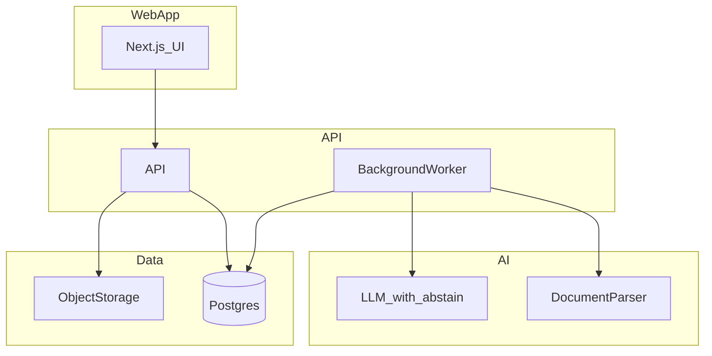

# BidHarbour architecture

Status: **design default for post-validation MVP**. Pilot path remains low-code/manual until scorecard GO.

As-of: 9 November 2025. Labels: architecture choices are **Working assumptions** until validated by build and pilot load.

## Paths

### A. Low-code / manual-assisted pilot (default now)

- Intake: email + shared drive / Notion database  
- Checklist: human-curated from uploaded pack (optional LLM assist)  
- Library: folder of approved PDFs + answer bank spreadsheet  
- Approval: named reviewer via email checklist  
- Export: assembled PDF/ZIP + change log  
- Cost control: no always-on infra; pay per LLM call only

### B. Lean custom SaaS MVP (after GO)

```
Web (Next.js) → API (Node or Rails) → Postgres
                     ↓
              Background worker → OCR / parser → LLM (abstain-capable)
                     ↓
              Object storage (per-org prefix)
```



## End-to-end document-processing sequence

1. User uploads Request pack (PDF/DOCX/XLSX allowlist).  
2. Virus scan + type check; store under `org/{id}/requests/{requestId}/`.  
3. Worker extracts text/tables → Requirement checklist (editable).  
4. Matcher links Requirements to ApprovedAnswer / DocumentVersion via EvidenceLink.  
5. Gaps: MISSING / EXPIRED / CONFLICT / CUSTOMER_SPECIFIC.  
6. Draft text suggestions only with source links; otherwise abstain.  
7. Approver reviews per section → Approval records.  
8. Export generated only if hard gates pass; write Export + AuditEvent.  
9. Model name/version and prompt hash logged on AI-assisted steps.

## Data model (core entities)

Organisation, User, Role, Customer, Request, Requirement, Document, DocumentVersion, ApprovedAnswer, EvidenceLink, Approval, Export, AuditEvent, Subscription.

**Shared company evidence** lives under Organisation.  
**Customer-specific submissions** live under Customer + Request and must not pollute the shared library without explicit promotion + approval.

## Tenant isolation

- `organisation_id` on all tenant tables  
- Storage key prefix per organisation  
- Prefer Postgres Row Level Security  
- No cross-tenant search indexes  
- Separate encryption envelope optional at higher tier

## API / domain boundaries

| Domain | Responsibility |
|--------|----------------|
| Identity | Auth, roles, MFA |
| Library | Documents, versions, approved answers, expiry |
| Requests | Upload, checklist, match, gaps |
| Approval | Review workflow, export gates |
| Billing | Stripe subscription, usage meters |
| Audit | Append-only AuditEvent stream |

## Build vs buy

| Concern | Buy / use | Rationale |
|---------|-----------|-----------|
| Auth | Clerk / Auth0 | MFA, SSO later, less custom risk |
| OCR | AWS Textract / Google Document AI | Table accuracy |
| LLM | Azure OpenAI or OpenAI with DPA | Abstain + audit |
| Object storage | S3 / R2 UK/EU | Cost + region |
| Email | Resend / SES | Notifications |
| Billing | Stripe | Standard SaaS |
| Observability | OpenTelemetry + provider | Cost control |

Avoid: microservices, Kubernetes, multiple primary databases, multi-region active-active in MVP.

## Cost controls

- Per-org monthly page/credit caps  
- Hard stop when quota exceeded  
- Cache embeddings/search per document version  
- Prefer extract-once; reprocess only on new DocumentVersion

## Staging and production

- Separate projects/accounts  
- No production customer data in staging without redaction  
- Backups: daily Postgres + object versioning; tested restore quarterly (ops runbook)
