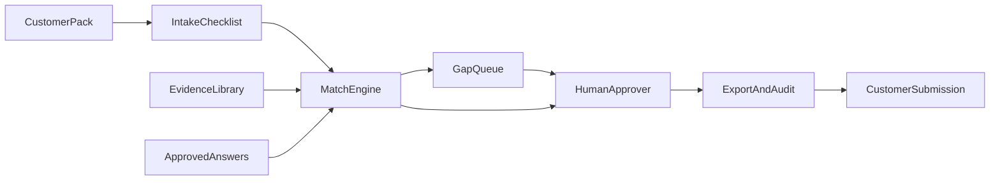
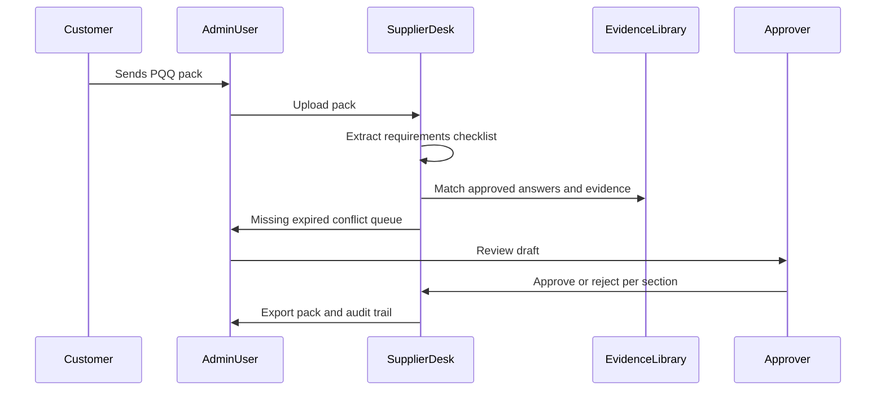
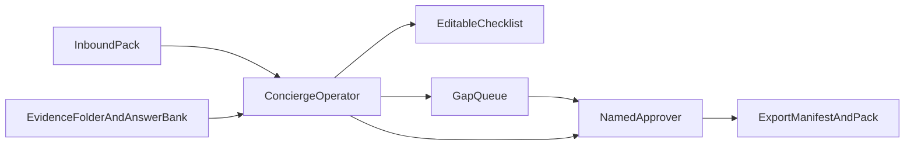
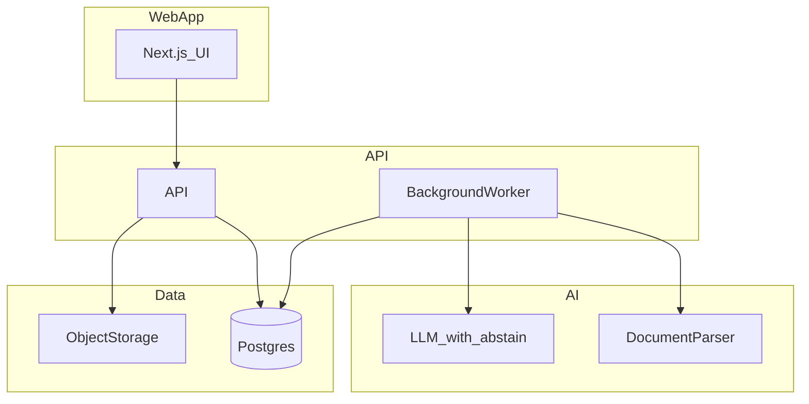
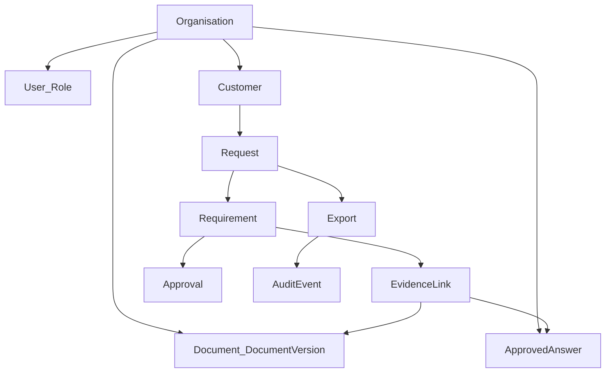
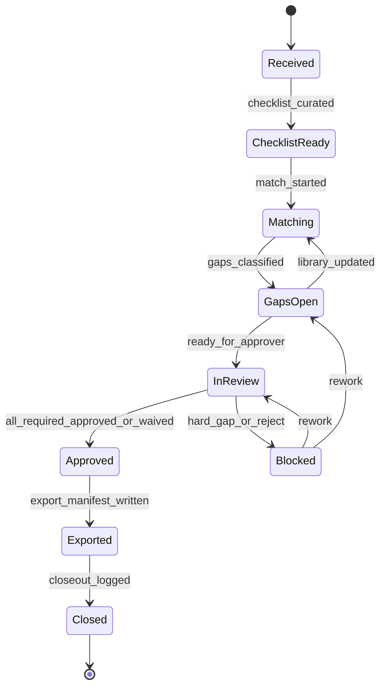

# BidHarbour — professional project writeup

**As of:** 11 November 2026  
**Product:** BidHarbour / first product **Supplier Desk**  
**Document standard:** NEA spine (Analysis → … → Appendices) **plus** senior full-stack / research-monograph technical depth — formal invariants, state machines, match algebra, threat model, data contracts, and evaluation epistemology. Filled iteratively from existing repo sources. *(Rigor of method — not a degree claim.)*  
**Posture:** **INVESTIGATE FURTHER** — validate Norfolk SME PQQ/SQ pack assembly via concierge pilots **before** production SaaS. Scorecard Actuals remain blank until founder interviews and paid pilots land real evidence.

This file is the single scrollable project narrative. It does **not** invent interviews, client quotes, sends, partnerships, or scorecard Actuals. Where live client evaluation is absent, that gap is stated explicitly and provisional evidence is limited to desk research and Path A synthetic dry-runs. Path B SaaS sections are **design intent only**.

---

## Evidence rules

Label material claims as **Verified fact**, **Reasoned inference**, **Working assumption**, **Proposed experiment**, or **Unresolved question** (standing orders in [`bidharbour-master-prompt.md`](bidharbour-master-prompt.md); fuller rules in [`../strategy/business-plan.md`](../strategy/business-plan.md)).

- AI may extract, match, and draft. **Only authorised humans approve statements and submissions.**
- Where evidence is missing, mark **MISSING** — never invent certifications, policies, insurance, financials, or contractual commitments.
- Distinguish shipped artefacts in git from founder-only field work (sends, interviews, solicitor clearance, IPO spend).

---

## Contents

| Part | Title | Status |
|------|--------|--------|
| 0 | How to read / evidence rules | **Filled** — 11 Nov 2026 |
| 1 | Executive summary & decision posture | **Filled** — 11 Nov 2026 |
| 2 | Analysis | **Filled** — 11 Nov 2026 |
| 3 | Design (+ §§3.8–3.12 senior deepen) | **Filled** — 11 Nov 2026 |
| 4 | Implementation (+ §4.7 control plane) | **Filled** — 11 Nov 2026 |
| 5 | Testing (DRY-001–007 + §5.6 properties) | **Filled** — 11 Nov 2026 |
| 6 | Evaluation (+ §§6.7–6.8 epistemology) | **Filled** — 11 Nov 2026 |
| 7 | Operator / user guide | **Filled** — 11 Nov 2026 |
| 8 | Bibliography | **Filled** — 11 Nov 2026 |
| 9 | Appendices (A–E + F–J senior) | **Filled** — 11 Nov 2026 |

---

## Part 0 — How to read this

**Last updated:** 11 November 2026

### Navigational spine

| Start | Path | Role |
|-------|------|------|
| Front door | [`../README.md`](../README.md) | Product one-liner + posture |
| Thin index | [`developer-map.md`](developer-map.md) | Folder map + decision gates |
| Living narrative | **this file** | Cumulative professional project writeup |
| Standing orders | [`bidharbour-master-prompt.md`](bidharbour-master-prompt.md) | Agent backlog + non-negotiables |
| Decision owner | [`../strategy/executive-decision.md`](../strategy/executive-decision.md) | INVESTIGATE FURTHER rationale |
| Business plan index | [`../strategy/business-plan.md`](../strategy/business-plan.md) | Sectional strategy outline |
| Validation truth | [`../research/validation-scorecard.md`](../research/validation-scorecard.md) | Criteria + Actuals (still blank pre-founder) |
| Monday ledger | [`../operations/monday-checklist.md`](../operations/monday-checklist.md) | Shipped artefact checklist |

### Shipped in git vs founder-only Actuals

| In git (agent / docs track) | Founder-only (do not invent) |
|-----------------------------|------------------------------|
| Runbooks, CRM packs A01–A50, Week 1–5 outreach, bounce triage, referral / rebook wave | Real outreach sends and reply logs |
| Path B kickoff / fee-waiver / retention / DSR / Approver / close-out artefacts | Live MSA/DPA with customers; solicitor clearance |
| DRY-001–007 pack dry-runs on redacted / synthetic fixtures | Paid pilot packs; minutes-saved Actuals |
| Interview / observation / time-study **templates** (blank Actuals) | Completed interviews; scorecard Actuals |
| Brand clearance checklists and decision memos | IPO / domain spend; HarbourResponse reserve actions |

### What this product is not

Not a generic file store; certificate-expiry tracker alone; supplier directory; buyer-side procurement portal; automated certification service; autonomous estimator; AI allowed to invent compliance answers; or a guarantee of qualification / contract awards. See README and executive decision.

### Post-GO pointer (deferred)

Production SaaS, auth/database scaffold, and engineering MVP implementation stay **out of scope** until validation scorecard **GO**. Intent docs only: [`../product/mvp-spec.md`](../product/mvp-spec.md), [`architecture.md`](architecture.md), [`../product/backlog.md`](../product/backlog.md). Design of the post-GO system is documented later in Part 3; it is **not** claimed as implemented.

### Lead surfaces this writeup consolidates

Hypothesis Lead vs SharePoint / inbound-pack scatter (see [`../research/competitors.md`](../research/competitors.md); no invented proof): inbound pack → structured checklist; evidence match + **MISSING** abstain; human Approver before export; multi-customer packs for one SME; Norfolk pilot price band £250–£750 ex VAT.

---

## Part 1 — Executive summary & decision posture

**Last updated:** 11 November 2026  
**Primary sources:** [`../strategy/executive-decision.md`](../strategy/executive-decision.md) (as-of 9 Nov 2025), [`../research/validation-scorecard.md`](../research/validation-scorecard.md), [`../README.md`](../README.md). Synthesis only — no new claims.

### Product thesis

BidHarbour’s first product, **Supplier Desk**, helps small UK suppliers turn each incoming customer questionnaire or document pack into a reviewer-approved response pack backed by their own evidence library. AI may extract, match, and draft; **only authorised humans approve** statements and submissions. Where evidence is unavailable, mark **MISSING** — never invent compliance answers. (See also “what this product is not” in Part 0 / README.)

### Exact proposed first customer (ICP)

Owner-managed **subcontract engineering, fabrication, or marine/offshore services firm** in **Norfolk** (Norwich, Great Yarmouth, King’s Lynn corridors), **5–75 employees**, selling to **multiple OEMs, tier-1s, or asset operators** that each send **different** qualification templates — not only public-sector tenders.  
*(From executive decision; firm-level demand unverified until interviews.)*

### Recurring problem & promised outcome

| Element | Statement | Label |
|---------|-----------|--------|
| Problem | Each new or renewed customer sends a PQQ/SQ/assurance pack; staff re-hunt certificates, policies, insurance, H&S answers, and case studies across email, SharePoint, and desktops — **2–8+ hours per pack**, with expiry/conflict risk. | Working assumption — must be measured in pilots |
| Promise | **≥40% reduction in admin minutes** from pack receipt to first complete human-approved draft, with **100% requirements mapped** to evidence or explicit missing flags. | Proposed experiment threshold |

### Decision posture

| Decision | Status |
|----------|--------|
| 8-week customer discovery + concierge pilots | **GO** |
| Production SaaS development | **NO-GO until scorecard** |
| Overall | **INVESTIGATE FURTHER** |

Live scorecard Actuals (interviews, observations, paid pilots, continuations) are still **0 / blank** until founder field work lands — see [`../research/validation-scorecard.md`](../research/validation-scorecard.md). Do not treat shipped runbooks as validation proof.

### Proof bar before significant SaaS spend

From the executive decision (thresholds mirrored on the scorecard):

- ≥6/10 interviews report the same recurring pain in **one** niche  
- ≥3 workflow observations with real redacted packs  
- **3 paid pilots**; **≥2** convert to paid continuation  
- Median **≥90 min saved** per pack vs baseline *(or customer-stated equivalent value ≥£150/pack)*

### Revenue model (hypothesis only)

Paid concierge pilot (**£250–£750** ex VAT) → setup/import → subscription band (**£99–£249**/mo). Hybrid managed-service + software acceptable if onboarding stays bounded. *(Proposed experiment — not validated prices.)*

### Fallback stance (do not silent-pivot)

Keep BidHarbour PQQ/SQ response assembly as primary. RFQ quoting is secondary **only if** PQQ validation fails. Holiday-property ops rejected for Norfolk entry. Narrowest entry: private inbound supply-chain packs for Norfolk AME + marine/offshore fabricators — exclude public tender writing as v1.

### Shipped vs founder Actuals

Agent/docs track has seeded ops, CRM, and dry-run artefacts in git. Founder still owns sends, interviews, solicitor-cleared MSA/DPA, and scorecard Actuals. See Part 0 table.

---

## Part 2 — Analysis

**Last updated:** 11 November 2026  
**Purpose:** Define the problem, intended users, desk research base, alternatives, objectives, models, constraints, and assumptions with professional NEA-grade rigour — **without fabricating clients or interview Actuals**.

### 2.1 Problem statement

Small UK suppliers that sell to multiple private customers repeatedly receive **customer-specific** Pre-Qualification Questionnaires (PQQs), Supplier Questionnaires (SQs), and assurance packs. Each pack asks for overlapping but non-identical certificates, policies, insurance schedules, H&S statements, capability claims, and case studies. Staff typically assemble responses by searching email, SharePoint, desktop folders, and prior Word exports. That process is slow, error-prone, and creates liability when expired or conflicting documents are submitted.

**Precise problem (working assumption until measured):** for Norfolk engineering / fabrication / marine SMEs in the ICP, assembling one inbound pack consumes **2–8+ hours** of admin time, with common failures of missed requirements, expired evidence, conflicting answers across packs, and rubber-stamp review without provenance.

**Job to be done:** turn each incoming customer pack into a **complete, evidence-backed, human-approved** response pack — mapping every requirement to approved evidence or an explicit **MISSING** / **EXPIRED** / **CONFLICT** flag — then export with an audit trail.

**Why this is a software-and-process problem (reasoned inference):** the failure modes are checklist completeness, evidence provenance, expiry/conflict detection, and gated human approval — not estimating skill or public-tender discovery. Substitutes (SharePoint alone, one-profile schemes, tender-AI drafting) do not close that loop for multi-customer private packs.

Primary sources: [`../strategy/executive-decision.md`](../strategy/executive-decision.md), [`../strategy/workflow-map.md`](../strategy/workflow-map.md).

### 2.2 Background

#### 2.2.1 Geographic and sector context

| Fact | Source path | Label |
|------|-------------|--------|
| Norfolk active enterprises stock ~33,130 (2023) | [`../strategy/norfolk-market-map.md`](../strategy/norfolk-market-map.md) citing Norfolk’s Story / ONS | Verified fact (as recorded in repo) |
| 99.7% of Norfolk enterprises &lt;250 employees; 88.3% &lt;10 | Norfolk market map | Verified fact (as recorded) |
| Advanced manufacturing & engineering: 2,150 businesses; 47,582 jobs; £2bn GVA (17%) | Norfolk Business Board via market map | Verified fact (as recorded) |
| NAAME: ~5,900 manufacturing businesses Norfolk & Suffolk; ~84,500 employed | naame.co.uk About via market map | Verified fact (as recorded) |

**Limitation:** sector brochure counts may mix enterprises and sites; firm-level questionnaire frequency remains **low confidence** until interviews ([`../strategy/market-size.md`](../strategy/market-size.md)).

#### 2.2.2 Why Norfolk AME / marine is the leading niche

The market map ranks **offshore energy & marine** and **manufacturing & engineering** as Lead attractiveness because they combine verified local density, multi-customer private qualification friction, accessible networks (NAAME, Hethel, EEEZ), and willingness-to-pay analogies in adjacent compliance/tender spend. Tourism/holiday accommodation is explicitly **Avoid** for Norfolk entry; buyer-side food QA and heavy regulated care are out of scope for v1.

#### 2.2.3 Reachable demand (low-confidence sketch)

Bottom-up Norfolk sketch ([`../strategy/market-size.md`](../strategy/market-size.md)): ~2,150 AME → assumed eligible multi-customer fraction → SAM ~430 enterprises → Y1 founder-reachable SOM ~13–22. ACV hypotheses £1.8k–£3.0k. **Conditional scenarios only** — not forecasts.

### 2.3 Intended users / stakeholders

**No live named clients are claimed in this document.** The following describes **intended** users derived from segmentation and the executive decision.

#### 2.3.1 Ideal customer profile (ICP)

| Dimension | Range | Label |
|-----------|-------|--------|
| Activity | CNC / fabrication / maintenance / marine services / small assemblies | Working assumption |
| Employees | 5–75 FTE | Working assumption |
| Turnover | £1m–£25m | Working assumption |
| Incoming packs | 6–30+ / year | Working assumption |
| Distinct customer templates | 3–15 | Working assumption |
| Current software | Microsoft 365 or Google Workspace; maybe light QMS | Working assumption |
| Admin resources | 0.5–1.5 FTE office/quality hybrid | Working assumption |
| Purchasing authority | MD can approve £99–£249/mo without board | Working assumption |

Source: [`../strategy/customer-segmentation.md`](../strategy/customer-segmentation.md).

#### 2.3.2 Buying / operating roles

| Role | Typical title | Job in the workflow |
|------|---------------|---------------------|
| Economic buyer | MD / Ops Director | Approves spend; cares about risk and time |
| Daily user | Quality / admin coordinator | Runs packs |
| Approver | MD or designated competent person | Signs off statements before export |
| Gatekeeper | IT / sometimes customer procurement | MFA, DPA, upload permission |
| Beneficiary | Estimators / engineers | Less document chase |

#### 2.3.3 Anti-personas (do not target)

- Sole traders with &lt;2 questionnaires/year  
- Firms only bidding public sector with a working tender subscription and no private packs  
- Enterprises needing full procurement suite / custom SSO in week one  
- Buyers seeking a supplier directory or accreditation scheme  
- Holiday-let operators (rejected fallback)

### 2.4 Research into the problem

#### 2.4.1 Desk research completed (in repo)

| Theme | Artefact | What it establishes | What it does **not** establish |
|-------|----------|---------------------|--------------------------------|
| Decision posture | [`../strategy/executive-decision.md`](../strategy/executive-decision.md) | INVESTIGATE FURTHER; GO discovery / NO-GO SaaS | Firm-level pain prevalence |
| Market / ICP | norfolk-market-map, customer-segmentation, market-size | Density + ICP hypothesis | Pack frequency Actuals |
| Workflow | [`../strategy/workflow-map.md`](../strategy/workflow-map.md) | Current→future steps; time assumptions | Measured minutes |
| Competition | [`../research/competitors.md`](../research/competitors.md) | Public pricing + Lead/Gap matrix (dated) | Whether buyers will pay BidHarbour |
| Validation design | [`../research/validation-scorecard.md`](../research/validation-scorecard.md), Week 4/8 gates, interview grid | Thresholds and instruments | Any completed interview Actuals (still 0) |
| Path A dry-runs | `operations/pack-dry-run-dry-001.md` … `dry-006.md` + `testdata/` | Fixture-based export-gate behaviour | Live customer pack behaviour |

#### 2.4.2 Planned primary research instruments (blank Actuals)

These instruments exist so founder fieldwork can be recorded honestly. **None are filled with invented respondents.**

| Instrument | Path | Status |
|------------|------|--------|
| Live validation scorecard | [`../research/validation-scorecard.md`](../research/validation-scorecard.md) | Actuals 0 / blank |
| 8-week interview grid | [`../research/interview-grid-8wk.md`](../research/interview-grid-8wk.md) | Template |
| Interview recording / synthesis | `research/recording-template.md`, `interview-synthesis.md` | Templates |
| Observation kit / session log | `research/observation-kit-naame-hethel.md`, `observation-session-log.md` | Templates |
| SharePoint / inbound-pack time-study | [`../research/interview-sharepoint-time-study.md`](../research/interview-sharepoint-time-study.md) | Blank Actuals |
| CRM first-50 + Week 1–5 outreach | `commercial/` | Packs/runbooks shipped; sends founder-only |

#### 2.4.3 Research honesty statement

Unlike a completed client-interview NEA Analysis section, BidHarbour **does not yet have** completed primary interviews or paid pilot Actuals. Analysis therefore rests on desk research + designed experiments. Claiming otherwise would violate evidence rules.

### 2.5 Alternative solutions

Job under comparison: **inbound customer-specific PQQ/SQ pack → checklist → evidence match → MISSING/conflict → human Approver → export**.

#### 2.5.1 Commercial and default substitutes

| Alternative | Why insufficient for this job | Evidence label |
|-------------|-------------------------------|----------------|
| Constructionline / CHAS-like schemes | One shared prequal profile; does not assemble **customer-specific** multi-template responses | Verified fact (product purpose + public pricing recorded in competitors.md) |
| Velstrian / KimonBids / TenderNation | Optimised for **tender discovery + AI drafting**; weak fit for private supply-chain packs; hallucination risk without strict evidence linking | Verified fact (published pricing recorded Nov 2025 / Nov 2026) |
| Evidash | **Buyer-side** vendor doc control; wrong persona; price far above Norfolk SME supplier band | Verified fact (public pricing recorded) |
| Complys | Contractor compliance toward main contractors / RAMS; not OEM inbound pack Approver export | Verified fact (public pricing recorded) |
| SharePoint + spreadsheets | Default £0 substitute; high labour; no checklist/match/approve/export gate | Reasoned inference |
| Manual consultant | £400–£800/day typical; not scalable for recurring packs | Reasoned inference (market rates) |
| QMS platforms | Controlled docs but overkill / wrong UX for inbound pack cycles | Reasoned inference |

Full matrix: [`../research/competitors.md`](../research/competitors.md).

#### 2.5.2 BidHarbour surface Lead / Gap (hypothesis)

| Surface | Posture | Lead / Parity / Gap |
|---------|---------|---------------------|
| Inbound pack → structured checklist | Concierge + fixtures | Lead (hypothesis) vs SharePoint; Gap vs SaaS until GO |
| Evidence match + MISSING abstain | Product principle | Lead vs tender-AI inventing prose |
| Human approval before export | Non-negotiable | Lead vs autonomous bid tools |
| Multi-customer packs | Core thesis | Lead vs single-profile schemes |
| Norfolk SME price | Pilot £250–£750 ex VAT | Lead vs buyer tools; Parity with mid SaaS *if* validated |
| Public tender discovery / RFQ estimating | Out of scope | Gap by design |

#### 2.5.3 Analysis conclusion on alternatives

Adjacent products prove willingness to pay for **some** compliance or tender-response work, but none clearly own the **supplier-side inbound multi-customer pack + evidence graph + Approver export** job at SME price. Differentiation remains a **hypothesis** until pilots measure time saved vs SharePoint.

### 2.6 Objectives

Objectives below adapt Must-have MVP capabilities ([`../product/mvp-spec.md`](../product/mvp-spec.md)) and validation thresholds into Functional (FO) and Non-Functional (NFO) objectives suitable for traceability. Pre-GO, FOs are satisfied by the **concierge operating system + fixtures** where noted; production SaaS realisation is deferred until scorecard GO.

#### 2.6.1 Functional objectives (FO)

| ID | Objective | Pre-GO realisation | Post-GO SaaS |
|----|-----------|--------------------|--------------|
| FO1 | Ingest an inbound customer pack and produce an editable requirement checklist | Path A/B runbooks + redacted fixtures | Request upload + parser |
| FO2 | Maintain an approved evidence library with ownership and review/expiry dates | Synthetic libraries + intake worksheets | Document / DocumentVersion |
| FO3 | Store approved reusable answers linked to evidence | Answer-bank pattern in pilots | ApprovedAnswer + EvidenceLink |
| FO4 | Match requirements to library; flag MISSING / EXPIRED / CONFLICT / CUSTOMER_SPECIFIC | DRY-001–006 method notes | Matcher worker |
| FO5 | Route drafts to a named human Approver; block export until gates pass | Approver training + export manifest | Approval records + hard gates |
| FO6 | Export a complete pack with evidence-version manifest and audit trail | Export manifest template | Export + AuditEvent |
| FO7 | Support multi-customer packs without polluting shared library without promotion | Pilot thesis + architecture rule | Customer + Request isolation |
| FO8 | Capture baseline and post-pack minutes for value proof | Baseline worksheet + metrics stub | In-product metrics later |
| FO9 | Honour retention, deletion, and DSR obligations for pilot data | Retention / DSR one-pagers | Productised DSR flows |
| FO10 | Abstain rather than invent compliance facts | Standing product principle | LLM abstain + provenance |

#### 2.6.2 Non-functional objectives (NFO)

| ID | Objective | Notes |
|----|-----------|--------|
| NFO1 | Trust / confidentiality | DPA/MSA solicitor path before real packs; UK GDPR awareness ([`legal-data-policy.md`](legal-data-policy.md)) |
| NFO2 | Auditability | Every match and export must show provenance |
| NFO3 | Maintainability of ops | Runbooks and monday checklist keep concierge repeatable |
| NFO4 | Cost control pre-GO | No always-on SaaS infra; Path A low-code/manual ([`architecture.md`](architecture.md)) |
| NFO5 | Honesty of validation | Scorecard Actuals never invented; blank until evidence |
| NFO6 | Usability for SME admins | Concierge + clear Approver path; SaaS UX deferred |
| NFO7 | Extensibility | Architecture entities allow post-GO SaaS without changing job-to-be-done |

#### 2.6.3 Justification and prioritisation

| Priority band | Objectives | Why first |
|---------------|------------|-----------|
| P0 | FO4, FO5, FO10, NFO1, NFO5 | Safety and trust: abstain, Approver, no fake Actuals, legal path |
| P1 | FO1–FO3, FO6–FO7 | Core pack assembly loop and multi-customer thesis |
| P2 | FO8–FO9, NFO2–NFO4, NFO6–NFO7 | Proof, compliance ops, economics, future SaaS |

Public tender discovery and RFQ estimating are **explicitly excluded** from v1 objectives (workflow-map scope control).

#### 2.6.4 Measurable success criteria

| Criterion | Threshold | Actual (as of writeup) | Pass? |
|-----------|-----------|------------------------|-------|
| Interview pain convergence | ≥6/10 same problem in niche | 0/10 | — |
| Workflow observations | ≥3 businesses | 0 | — |
| Paid pilots | 3 | 0 | — |
| Continuations | ≥2 | 0 | — |
| Time/value | ≥90 min saved median or ≥£150/pack value | — | — |
| Admin minutes reduction (product promise) | ≥40% vs baseline | — | — |
| Requirements mapped | 100% to evidence or explicit missing flags | Fixture dry-runs only | Provisional on Path A |
| Export gate | Block on MISSING/EXPIRED/CONFLICT without waiver | Demonstrated on DRY-001–006 fixtures | Provisional |

Source of live Actuals table: [`../research/validation-scorecard.md`](../research/validation-scorecard.md).

#### 2.6.5 Objective validation criteria

| Objective set | How validated | When |
|---------------|---------------|------|
| FO1–FO6 (process) | Path A dry-runs on redacted/synthetic fixtures; Path B live packs after MSA/DPA | Dry-runs done in git; live pending |
| FO8 / time promise | Time-study + baseline worksheet + pilot metrics | Founder / pilot |
| FO9 / NFO1 | Solicitor-cleared stubs + retention/DSR drills | Before real packs |
| Market FOs / WTP | Interviews + paid pilots + continuations | Scorecard Week 4 / Week 8 gates |
| Post-GO SaaS FOs | Release criteria in mvp-spec (two real packs on software, export gate tests, zero cross-tenant) | After GO only |

### 2.7 Modelling the problem

#### 2.7.0 Problem decomposition

| Sub-problem | Description | Maps to |
|-------------|-------------|---------|
| D1 Intake | Receive and version the customer pack | FO1 |
| D2 Understand | Extract / curate requirement checklist | FO1 |
| D3 Library | Maintain approved evidence and answers | FO2–FO3 |
| D4 Match | Link requirements to library; classify gaps | FO4, FO10 |
| D5 Approve | Human review per section | FO5 |
| D6 Export | Pack + manifest + audit | FO6 |
| D7 Multi-buyer | Isolate customer-specific vs shared library | FO7 |
| D8 Measure | Baseline vs actual minutes | FO8 |

#### 2.7.1 Current-state → future-state workflow

From [`../strategy/workflow-map.md`](../strategy/workflow-map.md) (times are working assumptions):

| Step | Current failure | Proposed intervention | Human approval |
|------|-----------------|----------------------|----------------|
| Receive | Wrong version filed | Versioned request upload | User confirms customer |
| Understand asks | Missed tables/clauses | Assisted checklist + human edit | User |
| Gather evidence | Expired/wrong file | Evidence library + expiry | User |
| Draft answers | Stale/unsupported claims | ApprovedAnswer match; abstain if none | Approver |
| Internal review | Rubber-stamp | Structured approval per section | **Approver** |
| Submit | Wrong attachment | Export pack + audit | Approver sign-off |
| Archive | Lost provenance | Request + export history | — |

**Time totals:** 3–8+ hours typical *(working assumption — measure in pilots).*

#### 2.7.2 Level-0 data flow (conceptual)



Sequence view (from workflow-map):



#### 2.7.3 Conceptual entity model

Core entities from [`architecture.md`](architecture.md) / mvp-spec (design intent; not claimed as implemented SaaS tables):

| Entity | Responsibility |
|--------|----------------|
| Organisation | Tenant boundary |
| User / Role | Admin, Editor, Approver, Viewer |
| Customer | Buyer whose template differs |
| Request | One inbound pack instance |
| Requirement | Checklist item from the pack |
| Document / DocumentVersion | Evidence with expiry/review |
| ApprovedAnswer | Reusable statement linked to evidence |
| EvidenceLink | Requirement ↔ answer/document |
| Approval | Per-section human decision |
| Export / AuditEvent | Gated output + provenance |

**Rule:** shared company evidence lives under Organisation; customer-specific submissions live under Customer + Request and must not pollute the shared library without explicit promotion + approval.

#### 2.7.4 Modelling summary

The problem decomposes cleanly into intake → match → abstain/gap → approve → export, with multi-customer isolation as a first-class concern. This model justifies both the **concierge Path A/B** operating system now and the **lean SaaS** path after GO, without requiring tender-discovery or estimating subsystems.

### 2.8 Requirement derivation process

| Input | Derived requirement class |
|-------|---------------------------|
| Desk research: SharePoint labour + multi-template pain (hypothesis) | FO1–FO4, FO7 |
| Product principle: never invent compliance | FO10, NFO5 |
| Liability / trust | FO5–FO6, NFO1–NFO2 |
| Norfolk SME economics | Pilot fee band; NFO4; subscription hypotheses in Part 1 |
| Legal-data policy | FO9; pre-pilot MSA/DPA artefacts |
| Competitive Lead surfaces | Emphasise Approver export + MISSING abstain over AI bid prose |
| Validation scorecard | Measurable success criteria §2.6.4 |

Derivation is **traceable and revisable**: if interviews falsify pack frequency or WTP, objectives and ICP narrow or STOP per executive decision — they do not silent-pivot to holiday ops.

### 2.9 Constraints

| Constraint | Detail | Label / source |
|------------|--------|----------------|
| Pre-GO no production SaaS | No auth/database scaffold until scorecard GO | Standing orders / architecture Path A |
| No invented Actuals | Interviews, sends, pilot metrics not fabricated | Evidence rules |
| No real customer packs in git | Redacted/synthetic fixtures only under `testdata/` | Legal / git rules |
| Legal before live packs | MSA/DPA solicitor review required | [`legal-data-policy.md`](legal-data-policy.md) |
| AI training | No training on customer documents without written DPA + product design | Legal-data policy |
| Brand | `bidharbour.com` occupied by unrelated EU auction entity — clear or rename before brand investment | Executive decision *(verified fact as recorded)* |
| Founder capacity | Execution branches part-time / full-time / two-person | `strategy/founder-scenarios.md` |
| Scope exclusions | No public tender v1; no RFQ estimating unless PQQ fails; no holiday ops | Workflow-map / executive decision |
| Region ≠ compliance | Hosting region alone does not establish UK GDPR compliance | Legal-data policy |

### 2.10 Assumptions

| ID | Assumption | Label |
|----|------------|--------|
| A1 | Target firms spend 2–8+ hours per inbound pack today | Working assumption |
| A2 | ≥6 packs/year is common enough in ICP to justify tooling | Working assumption |
| A3 | MD can approve £99–£249/mo without board for fitting ICP | Working assumption |
| A4 | Pilot fee £250–£750 ex VAT is acceptable for a measured pack window | Proposed experiment |
| A5 | Multi-customer private packs are the painful job (not Constructionline alone) | Reasoned inference / hypothesis |
| A6 | Concierge Path A can prove the loop before SaaS | Proposed experiment |
| A7 | Human Approver will be accepted as necessary (not a sales blocker) | Working assumption |
| A8 | Norfolk AME/marine density yields reachable SOM via founder-led sales | Working assumption (market-size) |
| A9 | RFQ and holiday fallbacks remain secondary/rejected unless PQQ validation fails | Decision constraint |
| A10 | DRY fixture behaviour is useful provisional evidence but **not** a substitute for live pilots | Methodological assumption |

---

## Part 3 — Design

**Last updated:** 11 November 2026  
**Status:** Design **intent** only. Path A (concierge / low-code) is the default now. Path B lean SaaS is specified for post-scorecard-GO build — **not claimed as implemented**.  
**Primary sources:** [`architecture.md`](architecture.md), [`../product/mvp-spec.md`](../product/mvp-spec.md), [`../design/ux-ia.md`](../design/ux-ia.md), Part 2 FO/NFO, DRY method notes under `operations/pack-dry-run-dry-*.md`.

### 3.1 Design goals / rationale

| Goal | Rationale | Maps to |
|------|-----------|---------|
| G1 Dual-path architecture | Prove the job with Path A before SaaS spend; keep Path B entity model aligned so pilots do not invent a dead-end process | NFO4, A6, FO1–FO7 |
| G2 Evidence-first matching | Every draft answer requires provenance; otherwise abstain | FO4, FO10, NFO2 |
| G3 Hard export gates | Export blocked on open MISSING / EXPIRED / CONFLICT / unapproved sections unless recorded waiver | FO5, FO6 |
| G4 Human Approver as a first-class role | Liability and trust; AI never silent-submits | FO5, NFO1 |
| G5 Multi-customer isolation | Shared library ≠ automatic customer-specific answers | FO7 |
| G6 SME-simple IA | Avoid procurement-suite complexity; empty states over fake dashboards | NFO6 |
| G7 Buy commodity, build the job | Auth/OCR/LLM/storage/billing bought; pack loop owned | NFO4, NFO7 |
| G8 Auditability | Append-only audit of AI assist, approvals, exports | NFO2, FO6 |
| G9 Honest validation surface | Design does not depend on invented interview Actuals | NFO5 |

#### Path A vs Path B trade-off

| Concern | Path A (now) | Path B (post-GO) |
|---------|--------------|------------------|
| Intake | Email + shared drive / Notion | Web upload → object storage |
| Checklist | Human-curated (± LLM assist) | Worker extract → editable checklist |
| Library | Approved PDF folder + answer bank sheet | Document / DocumentVersion / ApprovedAnswer |
| Approval | Named reviewer via email checklist | Approvals inbox + role enforcement |
| Export | Assembled ZIP/PDF + change log / manifest | Gated Export + AuditEvent |
| Cost | No always-on infra; pay-per-LLM | Caps, extract-once, staging/prod split |

**Trade-off accepted:** Path A is slower operationally and less productised, but it validates FO/NFO without premature SaaS. Path B reuses the same decision procedure (§3.4) and entities (§3.3).

#### Technology selection (Path B — working assumptions)

| Concern | Buy / use | Why |
|---------|-----------|-----|
| Auth | Clerk / Auth0 | MFA, later SSO; less custom risk |
| OCR | AWS Textract / Google Document AI | Table accuracy |
| LLM | Azure OpenAI or OpenAI with DPA | Abstain + audit; contractual no-train preferred |
| Object storage | S3 / R2 UK/EU | Cost + region |
| Email | Resend / SES | Notifications |
| Billing | Stripe | Standard SaaS |
| Observability | OpenTelemetry + provider | Cost control |

**Avoid in MVP:** microservices, Kubernetes, multiple primary databases, multi-region active-active.

### 3.2 System architecture

#### 3.2.1 Path A — concierge / low-code (default now)



Operators follow [`../operations/concierge-pilot-runbook.md`](../operations/concierge-pilot-runbook.md). Fixtures under `testdata/` exercise the loop without live customer packs.

#### 3.2.2 Path B — lean SaaS MVP (after GO)

```
Web (Next.js) → API (Node or Rails) → Postgres
                     ↓
              Background worker → OCR / parser → LLM (abstain-capable)
                     ↓
              Object storage (per-org prefix)
```



#### 3.2.3 End-to-end processing sequence (Path B intent)

1. Upload Request pack (PDF/DOCX/XLSX allowlist).  
2. Virus scan + type check; store under `org/{id}/requests/{requestId}/`.  
3. Worker extracts text/tables → editable Requirement checklist.  
4. Matcher links Requirements to ApprovedAnswer / DocumentVersion via EvidenceLink.  
5. Classify gaps: MISSING / EXPIRED / CONFLICT / CUSTOMER_SPECIFIC.  
6. Draft suggestions only with source links; otherwise abstain.  
7. Approver reviews per section → Approval records.  
8. Export only if hard gates pass; write Export + AuditEvent.  
9. Log model name/version and prompt hash on AI-assisted steps.

#### 3.2.4 Domain boundaries

| Domain | Responsibility |
|--------|----------------|
| Identity | Auth, roles, MFA |
| Library | Documents, versions, approved answers, expiry |
| Requests | Upload, checklist, match, gaps |
| Approval | Review workflow, export gates |
| Billing | Stripe subscription, usage meters |
| Audit | Append-only AuditEvent stream |

#### 3.2.5 Error handling, safety, extensibility

| Concern | Design response |
|---------|-----------------|
| Unsafe AI prose | Abstain without provenance; uncertain extraction banner |
| Export of incomplete packs | Hard gates + optional recorded waiver only |
| Cross-tenant leakage | `organisation_id` on tenant tables; storage prefix; prefer RLS; no cross-tenant search indexes |
| Quota blow-ups | Per-org page/credit caps; hard stop; extract-once |
| Extensibility | New gap types / customer overrides without changing Approver gate |
| Staging safety | Separate projects; no production customer data in staging without redaction |

### 3.3 Data / class design

#### 3.3.1 Core entities

Organisation, User, Role, Customer, Request, Requirement, Document, DocumentVersion, ApprovedAnswer, EvidenceLink, Approval, Export, AuditEvent, Subscription.

**Shared company evidence** lives under Organisation.  
**Customer-specific submissions** live under Customer + Request and must not pollute the shared library without explicit promotion + approval.

#### 3.3.2 Conceptual relationships



#### 3.3.3 Tenant isolation

- `organisation_id` on all tenant tables  
- Storage key prefix per organisation  
- Prefer Postgres Row Level Security  
- No cross-tenant search indexes  
- Separate encryption envelope optional at higher tier  

#### 3.3.4 Roles (mvp-spec)

Admin, Editor, Approver, Viewer — Approver required for approve/export; MFA available (post-GO).

### 3.4 Match / MISSING algorithm

This is the **decision procedure** shared by Path A operators and Path B matcher. It is an ops/algorithm design, not a claim of shipped SaaS code. Formal fixture evidence: DRY-001–006 (`operations/pack-dry-run-dry-*.md`).

#### 3.4.1 Inputs

- Editable checklist of Requirements for one Request  
- Organisation evidence library (documents + approval_status + expiry/review dates + doc keys)  
- Approved answer bank (optional)  
- As-of date for expiry comparison  

#### 3.4.2 Procedure (per requirement)

1. Attempt match on `doc_key` / semantic answer key against library rows with `approval_status=approved`.  
2. If no key or `not_held` → status **MISSING**; do not invent content.  
3. If matched approved row has `expiry_or_review_date` &lt; as_of → **EXPIRED**; cite label; do **not** silent-fill a fresh cert.  
4. If &gt;1 in-date approved row for the same key with materially different labels/summaries → **CONFLICT**; cite **both**; no newest-wins silent pick.  
5. If answer is valid only for a named buyer / template → **CUSTOMER_SPECIFIC**; do not promote to shared library without Approver.  
6. If single clean match → draft with provenance (document title, version, section if known, retrieved date, expiry).  
7. If AI assist used without adequate provenance → **abstain** (FO10).  
8. First complete draft = every requirement reviewed with cite, MISSING, EXPIRED, CONFLICT, or CUSTOMER_SPECIFIC.  
9. Approver reviews; Export blocked while hard gaps or unapproved required sections remain (unless recorded waiver).  
10. On export: write manifest of evidence versions + audit trail.

#### 3.4.3 Export hard gates

| Gate | Block export when |
|------|-------------------|
| MISSING | Required item has no evidence |
| EXPIRED | Cited evidence past review/expiry |
| CONFLICT | Unresolved dual answers |
| Draft-only / unapproved | Approver not signed off |
| Waiver | Only if explicit waiver recorded (pilot policy) |

#### 3.4.4 Complexity note

For Path A, cost is linear in checklist size × library lookup time (human or sheet filter). For Path B, design prefers extract-once per DocumentVersion and cached retrieval — **working assumption** until built. Do not invent benchmark timings.

### 3.5 Interface design / information architecture

**Label:** [`../design/ux-ia.md`](../design/ux-ia.md) describes the **post-GO SaaS** IA. Path A mirrors the same journeys with folders, checklists, and email Approver loops.

#### 3.5.1 Primary user journeys

1. Onboard evidence library  
2. Create / upload new request  
3. Resolve missing / expired / conflicts  
4. Approver review  
5. Export pack  
6. Offboard / export-delete data  

#### 3.5.2 Navigation structure (SaaS intent)

```
Home (Requests)
Library (Documents | Approved answers)
Customers
Approvals (inbox)
Settings (Users | Billing | Security | Data export)
```

#### 3.5.3 Screen map

| Screen | Purpose |
|--------|---------|
| Request list | Status, due dates, gaps count |
| Request detail | Checklist + match + evidence + approval |
| Library document | Versions, expiry, owner |
| Answer bank | Approved text + links |
| Approval inbox | Items awaiting named Approver |
| Export viewer | Manifest + download |
| Empty states | CTA to upload first library / first request — no fake dashboards |

#### 3.5.4 Approval flow

Editor marks Ready for review → Approver sees per-requirement Approve / Reject / Request change → Export enabled only when gates pass → AuditEvent written.

#### 3.5.5 States, device, accessibility

| Topic | Design |
|-------|--------|
| Empty / loading / error / permission | Plain CTA; skeletons; recoverable errors; explain missing role |
| Desktop vs mobile | Desktop authoring; mobile approve/reject + notifications |
| Accessibility | WCAG 2.2 AA target: keyboard order; status not by colour alone; labelled inputs; contrast; no drag-only actions |
| Provenance display | Title, version, page/section, retrieved date, expiry; uncertain banner: “Model suggestion — verify against source.” |

#### 3.5.6 Conflict / gap presentation (illustrative)

Request detail shows per-requirement Match / Evidence / Status (OK, MISSING, CONFLICT, …) with **Export blocked** summary when open items remain — same information model as Path A dry-run worksheets.

### 3.6 Data dictionary (key fields)

Conceptual fields for design/traceability — not a live schema dump.

| Entity | Key fields | Notes |
|--------|------------|-------|
| Organisation | id, name, region_prefs | Tenant root |
| User / Role | user_id, org_id, role ∈ {Admin,Editor,Approver,Viewer} | Enforce approve/export |
| Customer | id, org_id, name | Multi-buyer axis |
| Request | id, customer_id, received_at, status, as_of_date | One inbound pack |
| Requirement | id, request_id, ref_code, question_text, status | Checklist row |
| Document | id, org_id, title, owner | Logical doc |
| DocumentVersion | id, document_id, version, expiry_or_review_date, storage_key, approval_status | Provenance + expiry |
| ApprovedAnswer | id, org_id, key, text, evidence_document_version_id | Reusable statement |
| EvidenceLink | requirement_id, answer_id or document_version_id, link_type | Match record |
| Approval | requirement_id, approver_id, decision, decided_at | Section gate |
| Export | request_id, manifest_json, exported_at, export_approved | Hard-gated |
| AuditEvent | id, org_id, actor, action, payload, created_at | Append-only |
| Subscription | org_id, plan, status | Post-GO billing |

### 3.7 Objective traceability matrix

| Objective | Design element |
|-----------|----------------|
| FO1 Ingest + checklist | Path A intake; Path B upload + worker extract; Request / Requirement |
| FO2 Evidence library + expiry | DocumentVersion.expiry_or_review_date; library screens |
| FO3 Approved answers | ApprovedAnswer + EvidenceLink |
| FO4 Match + gap flags | §3.4 procedure; gap queue UI |
| FO5 Human Approver + block export | Approval domain; Approvals inbox; hard gates |
| FO6 Export + audit | Export + AuditEvent; manifest |
| FO7 Multi-customer | Customer entity; no silent library pollution |
| FO8 Minutes proof | Baseline worksheet / metrics stub (ops); future meters |
| FO9 Retention / DSR | Settings data export/delete; legal artefacts |
| FO10 Abstain | Matcher abstain; uncertain banner; no invent |
| NFO1 Trust | DPA path; MFA; tenant isolation |
| NFO2 Auditability | AuditEvent; provenance display |
| NFO3 Maintainable ops | Path A runbooks; domain boundaries |
| NFO4 Cost control | Path A default; Path B caps / buy-not-build |
| NFO5 Honest validation | Design independent of invented Actuals |
| NFO6 SME usability | ux-ia journeys; empty states |
| NFO7 Extensibility | Entity model + gap types; Path A→B continuity |

### 3.8 Domain invariants (safety properties)

Design-time predicates that must hold for any correct Path A run or Path B implementation. Notation: English predicates over domain state *(working assumptions until encoded in tests)*.

| ID | Invariant | Informal predicate |
|----|-----------|-------------------|
| I1 | No invent | ∀ requirement: draft text ⇒ provenance EvidenceLink ∨ status ∈ {MISSING, EXPIRED, CONFLICT, CUSTOMER_SPECIFIC, abstain} |
| I2 | Hard export gate | Export.export_approved = true ⇒ ¬∃ required requirement with unresolved hard gap ∧ Approver recorded |
| I3 | Approver non-bypass | Export ⇒ ∃ Approval by Role=Approver (or explicit waiver record) |
| I4 | Tenant isolation | ∀ records r: r.organisation_id = session.org (Path B); Path A = named-access register |
| I5 | FO7 scope | Cite(customer-scoped answer, request) ⇒ answer.customer_id = request.customer_id |
| I6 | Shared promotion | SharedLib ← ScopedAnswer only via Approver + applies_to change (DRY-007 method) |
| I7 | Audit append-only | AuditEvent never updated/deleted in place (Path B intent) |
| I8 | Expiry honesty | as_of > expiry_or_review_date ⇒ status ≠ OK for that cite |

Violation of I1–I3 or I5 in ops is a **process defect**; in SaaS it must be a **hard test failure**.

### 3.9 Request lifecycle state machine



**Illegal transitions (must reject):** `Exported` ← from `GapsOpen` / `Blocked` without Approver; `Matching` → `Exported` skipping review; any transition that invents evidence to clear MISSING.

Full transition table: Appendix F.

### 3.10 Match algebra

Treat matching as a pure function (Path A: operator applies by hand; Path B: matcher worker):

```
Match(req, sharedLib, scopedLib?, customerId, as_of) →
  { status, cites[], reason }
```

**Lookup order**

1. `sharedLib` rows with `approval_status=approved` and `applies_to` compatible with pack type.  
2. If `scopedLib` present: rows with `customer_id = customerId` and `scope=customer` only (FO7 / I5).  
3. Never read another customer’s scoped store.

**Status precedence** (highest wins when multiple conditions apply to the same requirement):

`CONFLICT` ≻ `EXPIRED` ≻ `MISSING` ≻ `CUSTOMER_SPECIFIC` ≻ `OK(draft+cite)`

| Condition | Status |
|-----------|--------|
| >1 in-date approved rows, materially different | CONFLICT (cite all; no newest-wins) |
| Single approved cite with expiry &lt; as_of | EXPIRED |
| not_held / no key / no usable row | MISSING |
| Valid only for named buyer template; not promoted | CUSTOMER_SPECIFIC or MISSING until scoped promote |
| Exactly one clean in-date cite | OK → draft with provenance |
| AI suggest without provenance | abstain (FO10) |

Worked characterisation: DRY-001–007 (Appendix I). Promotion without shared pollution: DRY-007.

### 3.11 Threat model (STRIDE sketch)

**Trust boundaries:** (1) customer pack contents; (2) operator/Approver workstation; (3) shared encrypted store; (4) optional LLM/OCR provider; (5) Path B app/API/DB/object storage.

| STRIDE | Path A risk | Path B risk | Mitigation (design / stubs) |
|--------|-------------|-------------|------------------------------|
| Spoofing | Wrong Approver identity | Stolen session | Named Approver; MFA (Path B buy auth) |
| Tampering | Quiet edit of draft/manifest | DB/object rewrite | Manifest + audit; append-only AuditEvent intent |
| Repudiation | “I never approved” | Missing audit | Export manifest initials; AuditEvent |
| Info disclosure | Pack on laptop / email | Cross-tenant read; LLM train | Named-access; DPA; tenant RLS; no-train contracts |
| DoS | Operator overload | LLM/OCR quota burn | Caps; Path A default pre-GO |
| Elevation | Editor exports | Role bypass | Role gate Approver; I3 |

Detail worksheet: Appendix G. Legal stubs remain counsel-gated ([`legal-data-policy.md`](legal-data-policy.md), `security-and-legal/`).

### 3.12 Consistency, idempotency, and contracts

| Concern | Design rule |
|---------|-------------|
| Export idempotency | Re-export same approved snapshot → same manifest content hash; new AuditEvent allowed |
| Approval | Per-requirement decisions; changing library after approve returns request to GapsOpen/InReview |
| FO7 promotion | Customer-scoped write ≠ shared write; shared promote is explicit second control |
| Path B resources | Organisation, User, Role, Customer, Request, Requirement, Document, DocumentVersion, ApprovedAnswer, EvidenceLink, Approval, Export, AuditEvent, Subscription — see §3.6 |
| LLM | Log model/version/prompt hash on assisted steps; never train on customer packs without written terms |

---

## Part 4 — Implementation

**Last updated:** 11 November 2026  
**Honesty:** This part documents **what is implemented in git** as the Path A concierge operating system, fixtures, and discovery scaffolding. It is **not** an appendix of production SaaS source code. Path B remains design-only until scorecard GO.

### 4.1 Overview

| Layer | Status |
|-------|--------|
| Path A concierge OS (runbooks, worksheets, manifests) | **Shipped** under `operations/` |
| Redacted / synthetic fixtures | **Shipped** under `testdata/` |
| Formal Path A dry-runs DRY-001–007 | **Shipped** under `operations/pack-dry-run-dry-*.md` + metrics stub |
| Commercial first-50 + outreach packs | **Shipped** templates under `commercial/` (sends founder-only) |
| Discovery / interview instruments | **Shipped** blank templates under `research/` |
| Legal / security stubs | **Shipped** drafts; solicitor clearance founder-only |
| Path B lean SaaS (Next.js / API / Postgres) | **Not built** — see Part 3 |

Ledger of shipped artefacts: [`../operations/monday-checklist.md`](../operations/monday-checklist.md).

### 4.2 Responsibility mapping (repo as system)

| Path | Responsibility | Maps to design domain |
|------|----------------|----------------------|
| `operations/` | Concierge pilot OS, dry-runs, metrics, Approver/export/close-out | Requests, Approval, Audit (manual) |
| `testdata/` | Redacted packs + synthetic libraries only | Library / Request fixtures |
| `commercial/` | CRM A01–A50, Week 1–5 packs, bounce, referral, stage scripts | Acquisition / pipeline (pre-product) |
| `research/` | Scorecard, interview/observation/time-study instruments | Validation evidence path |
| `security-and-legal/` | DPA/MSA stubs, DSR, breach drafts, named-access | NFO1 / FO9 |
| `product/`, `design/`, `Docs/architecture.md` | MVP intent, IA, architecture | Path B design |
| `Docs/project-writeup.md` | This professional writeup | Traceability / evaluation |
| `engineering/` | Empty until GO | Deferred |

Thin index: [`developer-map.md`](developer-map.md).

### 4.3 Concierge OS artefacts

| Capability | Artefact | Notes |
|------------|----------|-------|
| End-to-end Path A runbook | [`../operations/concierge-pilot-runbook.md`](../operations/concierge-pilot-runbook.md) | Intake → match → Approver → export |
| Kickoff (Path B-0 gates) | [`../operations/pilot-kickoff-checklist.md`](../operations/pilot-kickoff-checklist.md) | MSA/DPA, fee, Approver, baseline, named access |
| First live pack intake | [`../operations/path-b-first-live-pack-intake.md`](../operations/path-b-first-live-pack-intake.md) | P01 worksheet; blank Actuals; no confidential content in git |
| Library intake | [`../operations/pilot-evidence-library-intake.md`](../operations/pilot-evidence-library-intake.md) + CSV | Taxonomy / approval_status / expiry |
| Missing queue email | [`../operations/missing-queue-email.md`](../operations/missing-queue-email.md) | Customer gap chase |
| Approver training | [`../operations/approver-review-training.md`](../operations/approver-review-training.md) | Export gate behaviour |
| Export manifest | [`../operations/export-manifest-template.md`](../operations/export-manifest-template.md) | Evidence-version manifest |
| Baseline minutes | [`../operations/baseline-minutes-worksheet.md`](../operations/baseline-minutes-worksheet.md) | FO8 pre-pilot |
| Fee / waiver log | [`../operations/pilot-fee-waiver-log.md`](../operations/pilot-fee-waiver-log.md) | Blank Actuals |
| Continuation log | [`../operations/pilot-continuation-log.md`](../operations/pilot-continuation-log.md) | Scorecard continuations |
| Support-burden log | [`../operations/pilot-support-burden-log.md`](../operations/pilot-support-burden-log.md) | Scorecard Support effort; blank Actuals |
| Close-out scripts | [`../operations/pilot-closeout-scripts.md`](../operations/pilot-closeout-scripts.md) | A–G close |
| Retention schedule | [`../operations/pilot-data-retention-schedule.md`](../operations/pilot-data-retention-schedule.md) | Align DPA |
| Metrics stub | [`../operations/pilot-metrics-stub.csv`](../operations/pilot-metrics-stub.csv) | DRY rows recorded |
| Dry-run reports | `operations/pack-dry-run-dry-001.md` … `dry-007.md` | Formal Path A evidence (Part 5) |

### 4.4 Fixtures

| Fixture | Role | Used by |
|---------|------|---------|
| [`../testdata/redacted-pqq-v1/`](../testdata/redacted-pqq-v1/) | Redacted PQQ pack (22-req style) | DRY-001, 003, 005, 006 |
| [`../testdata/redacted-sq-v1/`](../testdata/redacted-sq-v1/) | Redacted SQ pack (18-req; Broads OEM fictional buyer) | DRY-002, 004 |
| [`../testdata/synthetic-evidence-library-v1/`](../testdata/synthetic-evidence-library-v1/) | Partial approved library | DRY-003, 004 |
| [`../testdata/synthetic-evidence-library-v1-expired/`](../testdata/synthetic-evidence-library-v1-expired/) | Expired EL schedule variant | DRY-005 |
| [`../testdata/synthetic-evidence-library-v1-conflict/`](../testdata/synthetic-evidence-library-v1-conflict/) | Conflicting PL schedules | DRY-006 |

**Rule:** no live customer packs in git. All dry-runs labelled synthetic process training — do **not** increment scorecard Actuals from them alone.

### 4.5 Commercial / discovery scaffolding

| Area | Artefacts | Implementation note |
|------|-----------|----------------------|
| CRM first-50 | `commercial/crm-readme.md`, A01–A50 contact-hint packs | Seeding done in git; outreach sends founder-only |
| Week 1–5 | `weekN-outreach-pack.md` + `weekN-send-runbook.md` + send-log CSVs | Templates/logs blank until founder sends |
| Bounce / OOO | [`../commercial/bounce-ooo-triage.md`](../commercial/bounce-ooo-triage.md) | Wired through Week-5 |
| Referral / rebook | `referral-ask-script.md`, `post-first50-referral-wave.md`, [`pilot-referral-evidence-packet.md`](../commercial/pilot-referral-evidence-packet.md), [`warm-intro-crm-intake.md`](../commercial/warm-intro-crm-intake.md) | Post-interview / post-first-50 / post–results-review / warm-intro CRM |
| Stage scripts | [`../commercial/crm-stage-scripts.md`](../commercial/crm-stage-scripts.md) | Discovery → pilot offer → Pilot |
| Pilot offer email | [`../commercial/pilot-offer-email.md`](../commercial/pilot-offer-email.md) | Solicitor-gated; no win-rate claims |
| Interview / observation | `research/interview-grid-8wk.md`, recording/synthesis templates, observation kit/log, time-study | Blank Actuals |

### 4.6 FO fulfilment confirmation (pre-GO)

| FO | Pre-GO realisation | Status |
|----|-------------------|--------|
| FO1 Ingest + checklist | Concierge runbook + redacted fixtures | **Implemented-as-ops** |
| FO2 Evidence library + expiry | Intake worksheet + synthetic libraries (incl. expired) | **Implemented-as-ops** |
| FO3 Approved answers | Library answer_summary / approval_status pattern | **Implemented-as-ops** (sheet/folder) |
| FO4 Match + gap flags | DRY method notes + Part 3 §3.4 procedure | **Implemented-as-ops**; characterised in Part 5 |
| FO5 Approver + block export | Approver training + all DRY export_approved=no demos | **Implemented-as-ops** |
| FO6 Export + audit | Export manifest template + dry-run reports | **Implemented-as-ops** |
| FO7 Multi-customer | DRY-002/004 Broads vs Harbour Wind differentiation | **Demonstrated on fixtures** |
| FO8 Minutes proof | Baseline worksheet + metrics stub columns | **Instrument shipped**; live Actuals founder/pilot |
| FO9 Retention / DSR | Retention schedule + DSR one-pager (security-and-legal) | **Draft shipped**; live clearance founder |
| FO10 Abstain | Standing rule + DRY no invent / no silent-fill | **Implemented-as-policy + dry-runs** |
| Path B SaaS FOs | mvp-spec / architecture | **Deferred-SaaS** |
| FO7 promotion | DRY-007 customer-scoped store | **Demonstrated on fixtures** |

### 4.7 Control plane (system under description)

Pre-GO, the **system** is not a deployed service — it is a **versioned control plane** in git:

| Plane | Role |
|-------|------|
| Runbooks / checklists | Executable procedure (human interpreter) |
| Fixtures + DRY reports | Characterisation harness for Match algebra + gates |
| Metrics stub + rollup templates | Measurement schema without filled Actuals |
| CRM / discovery packs | Acquisition state machine outside pack assembly |
| This writeup | Spec + evaluation epistemology |

**Replay semantics:** Any operator should be able to re-run DRY-00N method sections and obtain the same gate outcomes (MISSING/EXPIRED/CONFLICT/export blocked). Divergence implies procedure drift — treat as a regression on I1–I3 / §3.10.

---

## Part 5 — Testing

**Last updated:** 11 November 2026  
**Evidence class:** Synthetic Path A characterisation tests. **Not** live client UAT. **Not** scorecard Actual increments.

### 5.1 Testing strategy

| Layer | Method | Purpose |
|-------|--------|---------|
| Characterisation (Path A) | DRY-001–007 on redacted/synthetic fixtures | Prove match/MISSING/EXPIRED/CONFLICT/FO7 promotion + Approver export gates |
| Metrics capture | `pilot-metrics-stub.csv` rows per DRY | Repeatable recording shape for future pilots |
| Regression of procedure | Method sections in each dry-run mirror Part 3 §3.4 | Prevent silent newest-wins / invent |
| Live pilot / interview tests | Scorecard + Path B after MSA/DPA | **Not executed** — Actuals still 0 |
| Automated unit/UI tests | N/A pre-GO | Deferred with SaaS |

**Justification:** Without production code, fixture dry-runs are the strongest honest test of the designed decision procedure. Claiming client UAT would violate evidence rules.

### 5.2 Formal DRY results table

| ID | Scenario | Pack fixture | Library | Key gap types observed | Export approved? | Report |
|----|----------|--------------|---------|------------------------|------------------|--------|
| DRY-001 | Empty library — PQQ | `redacted-pqq-v1` | none | 22/22 MISSING | **no** (blocked) | [`../operations/pack-dry-run-dry-001.md`](../operations/pack-dry-run-dry-001.md) |
| DRY-002 | Empty library — SQ (Broads) | `redacted-sq-v1` | none | 18/18 MISSING; multi-customer note | **no** | [`../operations/pack-dry-run-dry-002.md`](../operations/pack-dry-run-dry-002.md) |
| DRY-003 | Partial library — PQQ | `redacted-pqq-v1` | `synthetic-evidence-library-v1` | 2/22 MISSING (+ draft-only case study) | **no** | [`../operations/pack-dry-run-dry-003.md`](../operations/pack-dry-run-dry-003.md) |
| DRY-004 | Partial library — SQ (Broads) | `redacted-sq-v1` | `synthetic-evidence-library-v1` | 6/18 MISSING (buyer/SQ deltas); 12 cites | **no** | [`../operations/pack-dry-run-dry-004.md`](../operations/pack-dry-run-dry-004.md) |
| DRY-005 | Expired library — PQQ | `redacted-pqq-v1` | `synthetic-evidence-library-v1-expired` | 1 EXPIRED (EL); 1 MISSING; draft-only | **no** | [`../operations/pack-dry-run-dry-005.md`](../operations/pack-dry-run-dry-005.md) |
| DRY-006 | Conflict library — PQQ | `redacted-pqq-v1` | `synthetic-evidence-library-v1-conflict` | 1 CONFLICT (PL £5m vs £10m); 1 MISSING; draft-only | **no** | [`../operations/pack-dry-run-dry-006.md`](../operations/pack-dry-run-dry-006.md) |
| DRY-007 | FO7 customer-scoped promotion | `redacted-sq-v1` + scoped answers | shared v1 **unchanged** + `synthetic-customer-scoped-answers-v1` | Broads MISSING 6→3; Harbour Wind must not cite Broads-scoped | **no** | [`../operations/pack-dry-run-dry-007.md`](../operations/pack-dry-run-dry-007.md) |
| DRY-008 | Dual-buyer pilot-window | `redacted-pqq-v1` → `redacted-sq-v1` | shared v1 + Broads scoped (Pack 2 only) | Pack1 HW 2 MISSING / no Broads-scoped; Pack2 Broads 3 MISSING + FO7; both blocked | **no** | [`../operations/pack-dry-run-dry-008.md`](../operations/pack-dry-run-dry-008.md) |
| DRY-009 | Filled manifest — Approver block | `redacted-pqq-v1` | `synthetic-evidence-library-v1` | 22/22 manifest rows; 2 MISSING + draft-only Q15; Block export | **no** | [`../operations/pack-dry-run-dry-009.md`](../operations/pack-dry-run-dry-009.md) · [`../operations/export-manifest-dry-009-filled.md`](../operations/export-manifest-dry-009-filled.md) |
| DRY-010 | Waiver ≠ Approver Approve | `redacted-pqq-v1` | `synthetic-evidence-library-v1` | Q3 operator `waived` without Approve; Q22 MISSING; Q15 draft; Block export | **no** | [`../operations/pack-dry-run-dry-010.md`](../operations/pack-dry-run-dry-010.md) · [`../operations/export-manifest-dry-010-filled.md`](../operations/export-manifest-dry-010-filled.md) |

Metrics rows: [`../operations/pilot-metrics-stub.csv`](../operations/pilot-metrics-stub.csv) (`export_approved=no` for each dry_run).

### 5.3 Gate coverage matrix

| Gate / condition | Covered by |
|------------------|------------|
| Empty library → all MISSING | DRY-001, DRY-002 |
| Partial library → residual MISSING | DRY-003, DRY-004 |
| Multi-customer buyer-specific MISSING | DRY-002, DRY-004 |
| EXPIRED blocks export (no silent renewal invent) | DRY-005 |
| CONFLICT blocks export (no newest-wins) | DRY-006 |
| FO7 scoped promote without shared pollution | DRY-007 |
| Dual-buyer in-window (PQQ then SQ; FO7 isolation) | DRY-008 |
| Filled manifest still blocks on hard gaps | DRY-009 |
| Recorded waiver without Approver Approve still blocks | DRY-010 |
| Draft-only / unapproved ≠ export | DRY-003–010 |
| Approver rework loop recorded | All DRY method sections |
| Waiver not used to fake pass | All DRY `export_approved=no` (esp. DRY-010) |

### 5.4 Edge cases and robustness

| Risk behaviour | Required behaviour | Evidence |
|----------------|--------------------|----------|
| Invent certs for `not_held` | Abstain → MISSING | DRY-001–006 method |
| Treat EXPIRED as OK / silent-fill fresh cert | Forbidden; cite EXPIRED | DRY-005 |
| Newest-wins on conflicting PL schedules | Forbidden; cite both → CONFLICT | DRY-006 |
| Reuse Harbour Wind answers for Broads deltas | Forbidden; keep MISSING | DRY-004 multi-customer note |
| Library presence implies export approval | Forbidden | All DRY Approver gates |

### 5.5 Objective verification (testing view)

| Objective | DRY / artefact outcome | Still untested |
|-----------|------------------------|----------------|
| FO4 Match + gaps | Empty/partial/expired/conflict paths demonstrated | Live customer libraries |
| FO5 Approver + block export | Export blocked on every DRY | Live Approver behaviour |
| FO6 Export + audit | Manifest template + dry-run reports | Live export to real buyer |
| FO7 Multi-customer | DRY-002/004/007 | Live multi-OEM packs |
| FO10 Abstain | No invent across DRY methods | LLM assist under load |
| FO8 / scorecard time & WTP | Instruments only | Interviews, paid pilots (Actuals 0) |
| NFO1 live legal | Drafts only | Solicitor-cleared MSA/DPA with customer |
| Path B SaaS correctness | — | Entire automated suite deferred |
| Invariants I1–I3, I5 | DRY gate outcomes | Encoded automated tests post-GO |

### 5.6 Property intents (post-GO test design)

| Property | Intent | Pre-GO evidence |
|----------|--------|-----------------|
| P-export-gate | No export while hard gaps open | All DRY `export_approved=no` |
| P-no-newest-wins | CONFLICT lists both cites | DRY-006 |
| P-no-silent-renew | EXPIRED ≠ OK | DRY-005 |
| P-tenant-FO7 | No cross-customer scoped cite | DRY-007 |
| P-no-invent | not_held → MISSING | DRY-001–004 |
| P-approver-required | Manifest / role gate | Approver training + DRY rework |

These become automated regression targets only after Path B exists — **not claimed implemented**.

---

## Part 6 — Evaluation

**Last updated:** 11 November 2026  
**Honesty:** No live client evaluation, interview transcripts, or UAT quotes are claimed. Judgement rests on desk research (Parts 1–2), design intent (Part 3), shipped Path A artefacts (Part 4), and DRY-001–007 characterisation tests (Part 5). Scorecard Actuals remain **0 / blank**.

### 6.0 Evaluation method

| Method | Used? | Role |
|--------|-------|------|
| Desk research synthesis | Yes | Problem, ICP, alternatives, constraints |
| Developer-led design review | Yes | FO/NFO ↔ Path A/B design |
| Fixture dry-runs (DRY-001–007) | Yes | Characterise match/export/FO7 gates |
| Live client interviews / UAT | **No** | Instruments exist; Actuals 0 |
| Paid pilot metrics | **No** | Metrics stub shape only |
| Automated SaaS test suite | **No** | Path B unbuilt |

**Limitation of method:** Fixture success does **not** prove willingness-to-pay, pack frequency, or retention. Those require founder fieldwork and paid pilots per [`../research/validation-scorecard.md`](../research/validation-scorecard.md).

### 6.1 Evaluation against functional objectives

| FO | Verdict (pre-GO) | Evidence | Residual gap |
|----|------------------|----------|--------------|
| FO1 Ingest + checklist | **Met (ops)** | Concierge runbook + redacted fixtures | Live pack upload UX (SaaS) |
| FO2 Evidence library + expiry | **Met (ops)** | Intake + synthetic libraries incl. expired | Live library at customer scale |
| FO3 Approved answers | **Met (ops)** | Library approval_status / answer_summary pattern | Productised answer bank UI |
| FO4 Match + gap flags | **Met (fixture)** | DRY-001–006 cover empty/partial/EXPIRED/CONFLICT | Live libraries; LLM assist load |
| FO5 Approver + block export | **Met (ops/fixture)** | Approver training; all DRY `export_approved=no` | Live Approver behaviour |
| FO6 Export + audit | **Met (ops)** | Manifest template + dry-run reports | Live buyer delivery |
| FO7 Multi-customer | **Met (fixture)** | DRY-002/004 Broads vs Harbour Wind | Live multi-OEM packs |
| FO8 Minutes proof | **Partial** | Baseline worksheet + metrics columns | No measured Actuals yet |
| FO9 Retention / DSR | **Partial** | Draft schedules/one-pagers | Solicitor-cleared live process |
| FO10 Abstain | **Met (policy + fixture)** | Standing rule; DRY no invent / no silent-fill | Production LLM under DPA |

### 6.2 Evaluation against non-functional objectives

| NFO | Verdict (pre-GO) | Evidence | Residual gap |
|-----|------------------|----------|--------------|
| NFO1 Trust / confidentiality | **Partial** | Legal-data policy + stubs; Path A named-access register | Cleared MSA/DPA with real customer |
| NFO2 Auditability | **Met (ops)** | Manifest + dry-run provenance cites | Append-only SaaS AuditEvent |
| NFO3 Maintainable ops | **Met (ops)** | Runbooks + monday ledger | Operator load at >3 concurrent pilots |
| NFO4 Cost control | **Met (by design)** | Path A default; no always-on SaaS | Path B quota design unproven in prod |
| NFO5 Honest validation | **Met** | Blank Actuals; no invented UAT in this writeup | Discipline must continue under pressure |
| NFO6 SME usability | **Partial** | IA designed; Path A human-operated | No SaaS usability test |
| NFO7 Extensibility | **Met (design)** | Shared §3.4 procedure Path A→B | Build risk post-GO |

### 6.3 Limitations of the current solution

1. **No primary customer evidence** — interviews 0/10; observations 0; paid pilots 0; continuations 0.  
2. **Path B SaaS unbuilt** — cannot claim production performance, tenancy, or UI acceptance.  
3. **Legal uncleared for live packs** — MSA/DPA solicitor path required before real customer documents.  
4. **Brand risk** — `bidharbour.com` conflict noted; HarbourResponse reserve / IPO steps founder-owned.  
5. **DRY ≠ pilot** — synthetic fixtures cannot measure real SharePoint baseline minutes or WTP.  
6. **Founder capacity unknown** — execution scenarios exist; not evaluated here as a pass/fail.

### 6.4 Critical reflection

DRY-001–006 **do** prove that the designed decision procedure can:

- force **MISSING** on empty/partial libraries without inventing evidence;  
- force **EXPIRED** and **CONFLICT** blocks without silent-fill or newest-wins;  
- keep **export blocked** until Approver approval/waiver;  
- differentiate **multi-customer** buyer-specific rows.

They **do not** prove the commercial thesis. Adjacent tender/compliance tools show spend exists in the market, but Supplier Desk’s Lead surfaces remain a **hypothesis** until pilots measure ≥90 minutes saved (or ≥£150/pack value) and ≥2 continuations.

**Do not silent-pivot** to holiday-property ops or RFQ estimating while PQQ validation is incomplete (Part 1 fallback stance).

### 6.5 Future improvements

| Priority | Action | Owner |
|----------|--------|-------|
| P0 | Execute Week-1 send runbook; book interviews; fill scorecard only after completed interviews | Founder |
| P0 | Solicitor-clear MSA/DPA before any live pack | Founder + counsel |
| P1 | Run ≥3 Path B paid pilots; log baseline minutes, continuation yes/no | Founder + operator |
| P1 | Week 4 / Week 8 gate decisions (GO / NARROW / PIVOT / STOP) | Founder |
| P2 | Only after scorecard GO: build Path B SaaS per Part 3; automated tests | Engineering |
| P2 | Brand clearance / rename decision before brand spend | Founder |

### 6.6 Summary vs measurable success criteria

| Criterion | Threshold | Actual | Pass? |
|-----------|-----------|--------|-------|
| Interview pain convergence | ≥6/10 | 0/10 | No |
| Workflow observations | ≥3 | 0 | No |
| Paid pilots | 3 | 0 | No |
| Continuations | ≥2 | 0 | No |
| Time/value | ≥90 min or ≥£150/pack | — | No |
| Admin minutes ≥40% reduction | Proposed experiment | — | No |
| 100% requirements mapped or flagged | Product promise | **Provisional on fixtures only** | Fixture-level yes; live no |
| Export gates | Block on MISSING/EXPIRED/CONFLICT | DRY-001–007 all blocked | Fixture-level yes |

**Overall evaluation verdict:** Path A **process and gates are ready for training and legal-cleared pilots**; the **business validation verdict remains INVESTIGATE FURTHER / not yet GO** for production SaaS.

### 6.7 Epistemology and false-GO risk

| Claim type | What fixture DRY can support | What only live evidence can support |
|------------|------------------------------|-------------------------------------|
| Gate/procedure correctness | High (characterisation) | Confirmation under real packs |
| Multi-customer isolation (FO7) | Medium (DRY-007 synthetic) | High (live two-buyer libraries) |
| Minutes saved / WTP | **None** (DRY minutes ≠ customer baseline) | Interviews + baseline + live metrics rollup |
| Retention / willingness to continue | None | Paid pilots + continuation log |
| SaaS tenancy / MFA / scale | None | Post-GO engineering + security tests |

**False-GO:** Declaring production SaaS GO because dry-runs pass and docs are thick. Mitigate with scorecard Actual thresholds (Part 2 §2.6.4) and explicit separation in Part 0 (shipped vs founder Actuals).

### 6.8 Construct validity — minutes-saved

The Time/value construct is **admin minutes (or £ equivalent) on inbound pack assembly**, not generic busyness and not dry-run wall-clock. Valid measurement path: interview time-study → kickoff baseline → live `pilot-metrics-stub` rows → [`../operations/minutes-saved-contrast-rollup.md`](../operations/minutes-saved-contrast-rollup.md). Using DRY `minutes_to_first_draft` as GO evidence is a **construct invalid** use.

---

## Part 7 — Operator / user guide

**Last updated:** 11 November 2026  
**Product name:** Supplier Desk (BidHarbour)

### 7.1 Audience

| Role | This guide is for |
|------|-------------------|
| Concierge operator | Runs Path A / Path B pack assembly |
| Named Approver | Signs or blocks every export |
| Founder | Discovery outreach + legal gates |

This is **not** an end-customer SaaS user manual (Path B UI unbuilt). Post-GO IA intent lives in Part 3 §3.5 / [`../design/ux-ia.md`](../design/ux-ia.md).

### 7.2 Path A / Path B happy path (operator)

Canonical detail: [`../operations/concierge-pilot-runbook.md`](../operations/concierge-pilot-runbook.md).

1. **Kickoff gates (live only):** MSA/DPA signed, fee/waiver logged, named Approver, baseline minutes worksheet started, named-access register, no model training on customer content — [`../operations/pilot-kickoff-checklist.md`](../operations/pilot-kickoff-checklist.md).  
2. **Library intake:** Capture documents with owner, approval_status, expiry/review — [`../operations/pilot-evidence-library-intake.md`](../operations/pilot-evidence-library-intake.md).  
3. **Receive pack:** Version the inbound PQQ/SQ; confirm buyer/customer.  
4. **Checklist:** Build/edit requirement list from the pack (do not invent asks).  
5. **Match:** Apply Part 3 §3.4 — cite library or mark MISSING / EXPIRED / CONFLICT / CUSTOMER_SPECIFIC.  
6. **MISSING queue:** Chase customer gaps — [`../operations/missing-queue-email.md`](../operations/missing-queue-email.md).  
7. **Approver review:** Hand draft + manifest; record rework loops — §7.3.  
8. **Export or block:** Fill [`../operations/export-manifest-template.md`](../operations/export-manifest-template.md); export only if gates pass or waiver recorded.  
9. **Metrics:** One row in [`../operations/pilot-metrics-stub.csv`](../operations/pilot-metrics-stub.csv).  
10. **Close-out / continuation:** [`../operations/pilot-closeout-scripts.md`](../operations/pilot-closeout-scripts.md) + [`../operations/pilot-continuation-log.md`](../operations/pilot-continuation-log.md).  
11. **Retention:** Follow [`../operations/pilot-data-retention-schedule.md`](../operations/pilot-data-retention-schedule.md).

**Dry-run shortcut:** Skip live legal/fee; use `testdata/` fixtures only; still enforce Approver gate.

### 7.3 Approver checklist

From [`../operations/approver-review-training.md`](../operations/approver-review-training.md):

- [ ] Every required row is `approved`, `waived` (with note), or still MISSING / EXPIRED / CONFLICT with export **blocked**  
- [ ] Each cited evidence label/version matches the document reviewed  
- [ ] Expiry/review dates checked; expired → EXPIRED block (or renew)  
- [ ] Conflicting in-date matches → CONFLICT; list both; pick or retire before approve  
- [ ] No silent-fill; MISSING queue sent if customer still owes evidence  
- [ ] Buyer-specific rows not copied from another buyer’s pack  
- [ ] No portal auto-submit by BidHarbour  
- [ ] You are named on the manifest and authorised for this org  

| Situation | Action |
|-----------|--------|
| Evidence on file, accurate, in date | Approve row |
| Customer confirmed not held / N/A | May waive (record rationale) |
| Still MISSING / EXPIRED / CONFLICT | **Block** export |

### 7.4 Dry-run practice (training)

1. Pick a DRY ID from Part 5 §5.2.  
2. Open the cited pack fixture + library (if any) under `testdata/`.  
3. Follow the method section in `operations/pack-dry-run-dry-00N.md`.  
4. Confirm export stays blocked for the documented reasons.  
5. Compare your outcome to the report table — do not “improve” results by inventing evidence.

Recommended training order: DRY-001 → 003 → 005 → 006 (PQQ gates), then DRY-002 → 004 (multi-customer SQ).

### 7.5 Founder discovery track

Parallel to ops training — **does not** invent sends or interview Actuals:

1. Primary action: [`../commercial/week1-send-runbook.md`](../commercial/week1-send-runbook.md) using A01–A10 contact hints; fill send log per real send.  
2. On replies: booking scripts → interview grid; update scorecard **only after** completed interviews.  
3. Continue Weeks 2–5 / referral wave per [`../operations/monday-checklist.md`](../operations/monday-checklist.md).  
4. After discovery: solicitor cover email before any real pack upload.

### 7.6 Hard stops

| Stop | Rule |
|------|------|
| Live customer packs | Forbidden until solicitor-cleared MSA/DPA signed |
| Invented compliance | Never — mark MISSING instead |
| Scorecard inflation | Do not increment Actuals from dry-runs or unsent outreach |
| Silent pivot | No holiday ops; RFQ only if PQQ validation fails |
| SaaS build | No production auth/database until scorecard GO |
| Git hygiene | No live customer files, secrets, or credentials in the repo |

---

## Part 8 — Bibliography

**Last updated:** 11 November 2026  

External statistics and competitor pricing in this writeup are cited **as recorded in the repo sources below** (with those files’ as-of dates). Open the linked file for primary URLs and evidence labels. This bibliography does **not** invent new scrapes or interview citations.

### 8.1 Strategy / decision

| Ref | Path | As-of (in file) |
|-----|------|-----------------|
| Executive decision | [`../strategy/executive-decision.md`](../strategy/executive-decision.md) | 9 Nov 2025 |
| Business plan index | [`../strategy/business-plan.md`](../strategy/business-plan.md) | — |
| Norfolk market map | [`../strategy/norfolk-market-map.md`](../strategy/norfolk-market-map.md) | 9 Nov 2025 |
| Customer segmentation | [`../strategy/customer-segmentation.md`](../strategy/customer-segmentation.md) | 9 Nov 2025 |
| Market size | [`../strategy/market-size.md`](../strategy/market-size.md) | 9 Nov 2025 |
| Workflow map | [`../strategy/workflow-map.md`](../strategy/workflow-map.md) | 9 Nov 2025 |
| Brand & positioning | [`../strategy/brand-and-positioning.md`](../strategy/brand-and-positioning.md) | — |
| Founder scenarios | [`../strategy/founder-scenarios.md`](../strategy/founder-scenarios.md) | — |
| Risk register | [`../strategy/risk-register.md`](../strategy/risk-register.md) | — |
| Roadmap | [`../strategy/roadmap.md`](../strategy/roadmap.md) | — |

### 8.2 Research / validation

| Ref | Path | Notes |
|-----|------|-------|
| Competitors & substitutes | [`../research/competitors.md`](../research/competitors.md) | Pricing observations dated 9 Nov 2025 / 10 Nov 2026 in-file |
| Copycat quarterly monitor | [`../research/copycat-monitor-quarterly.md`](../research/copycat-monitor-quarterly.md) | Public-page checklist; Complys / tender-AI; blank until real pass |
| Validation scorecard | [`../research/validation-scorecard.md`](../research/validation-scorecard.md) | Actuals blank until founder evidence |
| Scorecard Actuals hygiene | [`../research/scorecard-actuals-hygiene.md`](../research/scorecard-actuals-hygiene.md) | Synthesis→scorecard; no invent |
| Week 4 / Week 8 gates | [`../research/week4-gate-checklist.md`](../research/week4-gate-checklist.md), [`../research/week8-gate-checklist.md`](../research/week8-gate-checklist.md) | — |
| Interview grid | [`../research/interview-grid-8wk.md`](../research/interview-grid-8wk.md) | Template |
| Recording / synthesis | `research/recording-template.md`, `research/interview-synthesis.md` | Templates |
| Observation kit / log | `research/observation-kit-naame-hethel.md`, `research/observation-session-log.md` | Templates |
| SharePoint time-study | [`../research/interview-sharepoint-time-study.md`](../research/interview-sharepoint-time-study.md) | Blank Actuals |
| Pilot design | [`../research/pilot-design.md`](../research/pilot-design.md) | — |
| Customer discovery programme | `research/customer-discovery-programme.md` | — |

### 8.3 Product / design / architecture / legal

| Ref | Path |
|-----|------|
| MVP spec | [`../product/mvp-spec.md`](../product/mvp-spec.md) |
| Product backlog | [`../product/backlog.md`](../product/backlog.md) |
| UX / IA | [`../design/ux-ia.md`](../design/ux-ia.md) |
| Architecture | [`architecture.md`](architecture.md) |
| Legal & data policy | [`legal-data-policy.md`](legal-data-policy.md) |
| Solicitor send / return intake | [`../security-and-legal/solicitor-send-checklist.md`](../security-and-legal/solicitor-send-checklist.md) · [`../security-and-legal/solicitor-return-intake-checklist.md`](../security-and-legal/solicitor-return-intake-checklist.md) |
| Pre-pilot legal readiness gate | [`../operations/pre-pilot-legal-readiness-gate.md`](../operations/pre-pilot-legal-readiness-gate.md) |

### 8.4 Operations / dry-runs / commercial

| Ref | Path |
|-----|------|
| Concierge pilot runbook | [`../operations/concierge-pilot-runbook.md`](../operations/concierge-pilot-runbook.md) |
| Path B first live pack intake | [`../operations/path-b-first-live-pack-intake.md`](../operations/path-b-first-live-pack-intake.md) |
| DRY-001 … DRY-006 | [`../operations/pack-dry-run-dry-001.md`](../operations/pack-dry-run-dry-001.md) … [`pack-dry-run-dry-006.md`](../operations/pack-dry-run-dry-006.md) |
| Pilot metrics stub | [`../operations/pilot-metrics-stub.csv`](../operations/pilot-metrics-stub.csv) |
| Monday checklist | [`../operations/monday-checklist.md`](../operations/monday-checklist.md) |
| Approver training / export manifest / kickoff / intake / close-out / continuation / baseline / retention | See Part 4 §4.3 |
| Fixtures | `testdata/redacted-pqq-v1/`, `redacted-sq-v1/`, `synthetic-evidence-library-v1/` (+ expired / conflict) |
| CRM / outreach | [`../commercial/crm-readme.md`](../commercial/crm-readme.md); Week 1–5 packs/runbooks; bounce; referral; stage scripts; pilot-offer email |

### 8.5 Standing orders / indexes

| Ref | Path |
|-----|------|
| Agent master prompt | [`bidharbour-master-prompt.md`](bidharbour-master-prompt.md) |
| README | [`../README.md`](../README.md) |
| Developer map | [`developer-map.md`](developer-map.md) |
| This writeup | [`project-writeup.md`](project-writeup.md) |

---

## Part 9 — Appendices

**Last updated:** 11 November 2026

### Appendix A — Artefact index

Condensed pointer; full ops ledger: [`../operations/monday-checklist.md`](../operations/monday-checklist.md). Narrative map: Part 4.

| Area | Where |
|------|-------|
| Concierge OS | `operations/` (runbook, kickoff, intake, Approver, manifest, close-out, metrics, DRY reports) |
| Fixtures | `testdata/` (redacted packs + synthetic libraries) |
| Commercial | `commercial/` (CRM A01–A50, Week 1–5, bounce, referral, stages) |
| Research instruments | `research/` (scorecard, grid, observation, time-study) |
| Security / legal stubs | `security-and-legal/` + `Docs/legal-data-policy.md` |
| Design intent | `product/`, `design/`, `Docs/architecture.md` |
| Docs / writeup | `Docs/` including this file |

### Appendix B — Dry-run evidence index

Full outcomes table: **Part 5 §5.2**. Do not treat as scorecard Actuals.

| ID | One-line | Report |
|----|----------|--------|
| DRY-001 | Empty library PQQ — 22 MISSING; export blocked | [`../operations/pack-dry-run-dry-001.md`](../operations/pack-dry-run-dry-001.md) |
| DRY-002 | Empty library SQ (Broads) — 18 MISSING; export blocked | [`../operations/pack-dry-run-dry-002.md`](../operations/pack-dry-run-dry-002.md) |
| DRY-003 | Partial library PQQ — residual MISSING; export blocked | [`../operations/pack-dry-run-dry-003.md`](../operations/pack-dry-run-dry-003.md) |
| DRY-004 | Partial library SQ — buyer deltas MISSING; export blocked | [`../operations/pack-dry-run-dry-004.md`](../operations/pack-dry-run-dry-004.md) |
| DRY-005 | Expired library PQQ — EXPIRED gate; export blocked | [`../operations/pack-dry-run-dry-005.md`](../operations/pack-dry-run-dry-005.md) |
| DRY-006 | Conflict library PQQ — CONFLICT gate; export blocked | [`../operations/pack-dry-run-dry-006.md`](../operations/pack-dry-run-dry-006.md) |

### Appendix C — Blank discovery templates index

| Instrument | Path | Status |
|------------|------|--------|
| Validation scorecard | [`../research/validation-scorecard.md`](../research/validation-scorecard.md) | Actuals **0 / blank** |
| Interview grid 8wk | [`../research/interview-grid-8wk.md`](../research/interview-grid-8wk.md) | Template |
| Recording / synthesis | `research/recording-template.md`, `interview-synthesis.md` | Templates |
| Observation kit / session log | `research/observation-kit-naame-hethel.md`, `observation-session-log.md` | Templates |
| SharePoint / inbound time-study | [`../research/interview-sharepoint-time-study.md`](../research/interview-sharepoint-time-study.md) | Blank Actuals |
| Week send logs | `commercial/week1-send-log.csv` … Week-5 | Blank until founder sends |
| Continuation / fee-waiver / support-burden logs | `operations/pilot-continuation-log.md`, `pilot-fee-waiver-log.md`, `pilot-support-burden-log.md` | Blank Actuals |

### Appendix D — FO / NFO quick reference

From Part 2 §2.6 (titles only).

| ID | Title |
|----|--------|
| FO1 | Ingest pack → editable checklist |
| FO2 | Approved evidence library + expiry/review |
| FO3 | Approved reusable answers linked to evidence |
| FO4 | Match + MISSING / EXPIRED / CONFLICT / CUSTOMER_SPECIFIC |
| FO5 | Human Approver; block export until gates pass |
| FO6 | Export pack + evidence-version manifest + audit |
| FO7 | Multi-customer isolation / no silent library pollution |
| FO8 | Baseline vs post-pack minutes capture |
| FO9 | Retention, deletion, DSR obligations |
| FO10 | Abstain rather than invent compliance facts |
| NFO1 | Trust / confidentiality |
| NFO2 | Auditability |
| NFO3 | Maintainability of ops |
| NFO4 | Cost control pre-GO |
| NFO5 | Honesty of validation |
| NFO6 | Usability for SME admins |
| NFO7 | Extensibility Path A→B |

### Appendix E — Document map (Parts 0–9)

| Part | Title |
|------|--------|
| 0 | How to read / evidence rules |
| 1 | Executive summary & decision posture |
| 2 | Analysis |
| 3 | Design (incl. §§3.8–3.12) |
| 4 | Implementation (incl. §4.7) |
| 5 | Testing (DRY-001–007; §5.6) |
| 6 | Evaluation (incl. §§6.7–6.8) |
| 7 | Operator / user guide |
| 8 | Bibliography |
| 9 | Appendices A–J |

**Writeup status:** Parts **0–9** complete; **senior deepen** §§3.8–3.12, 4.7, 5.6, 6.7–6.8 + Appendices **F–J** as of 11 Nov 2026.

### Appendix F — Request lifecycle transition table

| From | Event | To | Guard |
|------|-------|----|-------|
| Received | checklist_curated | ChecklistReady | Checklist editable; pack versioned |
| ChecklistReady | match_started | Matching | — |
| Matching | gaps_classified | GapsOpen | Every req has status |
| GapsOpen | ready_for_approver | InReview | Draft complete (cites or gaps) |
| InReview | all_required_approved_or_waived | Approved | I2, I3 |
| InReview | hard_gap_or_reject | Blocked | — |
| Blocked | rework | GapsOpen or InReview | No invent |
| Approved | export_manifest_written | Exported | I2 |
| Exported | closeout_logged | Closed | Metrics/continuation as applicable |
| GapsOpen | library_updated | Matching | Re-match after intake/promote |

Forbidden: any path to Exported that skips Approver or leaves unresolved hard gaps without waiver.

### Appendix G — Threat-model worksheet

| Boundary | Assets | Primary threats | Controls |
|----------|--------|-----------------|----------|
| Operator laptop / email | Pack files, drafts | Disclosure, tampering | Named-access register; encrypted path; no git of live packs |
| Approver channel | Approval decisions | Spoofing, repudiation | Named Approver; manifest initials |
| Shared library store | Evidence versions | Pollution, wrong cite | FO7 scoped store; Approver promote |
| LLM/OCR (optional) | Pack text | Training/disclosure | DPA; no-train; abstain without provenance |
| Path B API/DB/object | All tenant data | Cross-tenant, elevation | org_id + RLS intent; roles; MFA |

STRIDE summary: §3.11.

### Appendix H — Entity field constraints / invariants checklist

| Entity | Constraint | Invariant |
|--------|------------|-----------|
| DocumentVersion | expiry_or_review_date optional but checked when present | I8 |
| ApprovedAnswer | requires evidence link or explicit policy-owned flag (mvp-spec) | I1 |
| EvidenceLink | points at one answer or document version | I1 |
| Approval | approver has Approver role | I3 |
| Export | blocked unless hard gates clear or waiver | I2 |
| Customer-scoped answer | customer_id required; scope=customer | I5, I6 |
| AuditEvent | append-only | I7 |

### Appendix I — Match worked examples → DRY-001–007

| Example | DRY | Algebra point |
|---------|-----|---------------|
| Empty lib → all MISSING | 001, 002 | MISSING branch |
| Partial shared cites | 003, 004 | OK + residual MISSING |
| Multi-customer deltas | 002, 004 | Buyer-specific MISSING |
| EXPIRED precedence | 005 | EXPIRED ≻ OK |
| CONFLICT precedence | 006 | CONFLICT ≻ OK; no newest-wins |
| Scoped promote FO7 | 007 | scopedLib lookup; shared unchanged |

### Appendix J — Post-GO engineering readiness checklist

Still **no build** until scorecard GO. When GO:

- [ ] Encode I1–I8 as automated tests  
- [ ] Implement §3.9 states in Request aggregate  
- [ ] Matcher implements §3.10 precedence + FO7  
- [ ] Tenant RLS + MFA smoke tests  
- [ ] Export gate property tests (Appendix §5.6)  
- [ ] Subprocessor DPA + no-train contracts live  
- [ ] Staging ≠ production data  
- [ ] Support runbook + privacy notice in force  

Intent refs: [`architecture.md`](architecture.md), [`../product/mvp-spec.md`](../product/mvp-spec.md), [`../product/backlog.md`](../product/backlog.md).

---

## Changelog

| Date | Change |
|------|--------|
| 11 Nov 2026 | Seeded living writeup: evidence rules, TOC, Chapter 0 navigational spine; chapters 1–10 queued as backlog #64–#68. |
| 11 Nov 2026 | Filled Chapter 1 — executive summary & decision posture (synthesis from executive-decision + scorecard; Actuals unchanged). |
| 11 Nov 2026 | Reframed document to NEA-grade Parts 0–9; filled Part 2 Analysis in full (no invented clients); re-queued Design→Appendices as backlog #66–#69. |
| 11 Nov 2026 | Filled Part 3 Design (goals, architecture Path A/B, data model, match/MISSING algorithm, IA, data dictionary, FO/NFO traceability); SaaS not claimed implemented. |
| 11 Nov 2026 | Filled Parts 4–5 — Implementation (artefact/fixture mapping) + Testing (DRY-001–006 formal evidence); no invented UAT. |
| 11 Nov 2026 | Filled Parts 6–7 — Evaluation (FO/NFO; no live clients) + Operator/user guide. |
| 11 Nov 2026 | Filled Parts 8–9 — Bibliography + Appendices; NEA-grade Parts 0–9 complete. |
| 11 Nov 2026 | Senior full-stack upgrade: §§3.8–3.12, 4.7, 5.6, 6.7–6.8; DRY-007 in test tables; Appendices F–J (invariants, state machine, threat model, match algebra, epistemology). |
