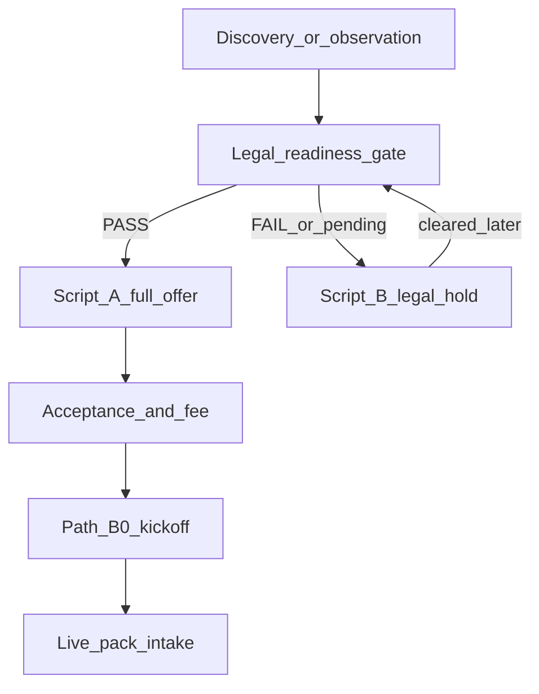

# Pre-pilot legal readiness gate

**Epic:** [#5](https://github.com/thesnjk/BidHarbour/issues/5)  
**Use before:** Script **A** paid-pilot outline ([`../commercial/pilot-offer-email.md`](../commercial/pilot-offer-email.md)) and any confidential pack acceptance path  
**Solicitor outbound:** [`../security-and-legal/solicitor-send-checklist.md`](../security-and-legal/solicitor-send-checklist.md) · [`../security-and-legal/solicitor-cover-email.md`](../security-and-legal/solicitor-cover-email.md)  
**Solicitor return intake:** [`../security-and-legal/solicitor-return-intake-checklist.md`](../security-and-legal/solicitor-return-intake-checklist.md)  
**Named access readiness:** [`../security-and-legal/pilot-named-access-register.md`](../security-and-legal/pilot-named-access-register.md)  
**After PASS + customer interest:** [`pilot-kickoff-checklist.md`](pilot-kickoff-checklist.md) (Path B-0)  
**Bridge:** [`../research/discovery-pilot-offer-bridge.md`](../research/discovery-pilot-offer-bridge.md)  
**Privacy / transfers stubs (counsel-gated):** [`../security-and-legal/pilot-privacy-notice-issue-spotter.md`](../security-and-legal/pilot-privacy-notice-issue-spotter.md) · [`../security-and-legal/international-transfers-decision-tree-annex-stub.md`](../security-and-legal/international-transfers-decision-tree-annex-stub.md)  
**Product name:** Supplier Desk

**Rule:** **Advice required.** Do **not** invent solicitor clearance, signatures, MFA ticks, or PASS dates in git. Cleared MSA/DPA stay in a **private vault** — never commit counsel drafts. Stubs ≠ customer contracts.

## Goal

One founder **PASS / FAIL** record so Script **A** and live packs never go out on uncleared stubs — without blocking discovery or Script **B** legal-hold.

## Funnel

| Stage | Owns |
|-------|------|
| **This gate** | Solicitor send; counsel-cleared MSA/DPA in vault; founder MFA / encrypted path / named-access **procedure** ready |
| **Kickoff** | Customer signatures, fee/waiver, Approver, baseline, per-customer access rows, evidence folder |
| **Runbook Path B** | Pack intake after kickoff |

---

## 1. Solicitor outbound

- [ ] Solicitor pack attached per [`../security-and-legal/solicitor-send-checklist.md`](../security-and-legal/solicitor-send-checklist.md)  
- [ ] Cover email sent ([`../security-and-legal/solicitor-cover-email.md`](../security-and-legal/solicitor-cover-email.md))  
- [ ] Date + firm logged in **private** notes (not git if sensitive)

## 2. Counsel return (PASS inputs)

Run [`../security-and-legal/solicitor-return-intake-checklist.md`](../security-and-legal/solicitor-return-intake-checklist.md) when drafts come back, then confirm:

- [ ] Cleared **pilot MSA** stored outside git / vault  
- [ ] Cleared **DPA** stored outside git / vault  
- [ ] No open counsel **blockers** on processing real packs  
- [ ] Privacy notice / international transfers guidance noted (stubs remain counsel-gated for customer send)  
- [ ] Subprocessor / data-flow inventory still aligned with Path A ([`../security-and-legal/subprocessors-and-data-flow.md`](../security-and-legal/subprocessors-and-data-flow.md))

## 3. Founder ops readiness (named access)

- [ ] MFA on founder accounts that will touch pilot data  
- [ ] Encrypted transfer path **defined** (procedure ready)  
- [ ] Named-access register **procedure** ready — per-customer rows come at kickoff  
- [ ] Incident / DSR stubs acknowledged (counsel-gated for customer send)

## 4. Exit criteria

| Result | Allowed | Not allowed |
|--------|---------|-------------|
| **PASS** (§1–3 complete) | Script **A**; proceed toward kickoff after acceptance | Treating stubs as signed contracts |
| **FAIL / pending** | Script **B** (`pilot_offer_held_legal`); discovery interviews without third-party packs | Script **A**; live packs; customer MSA/DPA stubs |

CRM: PASS + Script A → `pilot_offer_sent`. Pending → Script B → `pilot_offer_held_legal` ([`../commercial/crm-stage-scripts.md`](../commercial/crm-stage-scripts.md)).

## 5. Hard stops

- Uncleared stubs sent as customer contracts  
- Script **A** while gate FAIL/pending  
- Live packs without **this gate PASS** + kickoff complete  
- Cleared counsel drafts committed to git  
- Invented PASS dates or MFA Actuals in the tracking table below  

## Tracking (blank until real)

| solicitor_sent_date | cleared_msa_dpa (Y/blank) | named_access_ready (Y/blank) | PASS_date | notes (no secrets) |
|---------------------|---------------------------|------------------------------|-----------|--------------------|
| | | | | |

Tally: **0** PASS · **0** pending (keep zero until founder fills privately or anonymised).

## Founder checklist

- [ ] §1–3 reviewed honestly  
- [ ] PASS or FAIL decided — no silent Script A  
- [ ] Bridge / offer email / CRM tags match exit criteria  
- [ ] Kickoff only after customer interest **and** this gate PASS  

## Related

- Legal policy spine: [`../Docs/legal-data-policy.md`](../Docs/legal-data-policy.md)  
- Solicitor return intake: [`../security-and-legal/solicitor-return-intake-checklist.md`](../security-and-legal/solicitor-return-intake-checklist.md)  
- Live runbook preconditions: [`concierge-pilot-runbook.md`](concierge-pilot-runbook.md)
