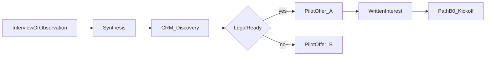

# Discovery / observation → paid pilot offer bridge

**Epic:** [#1](https://github.com/thesnjk/BidHarbour/issues/1)  
**Purpose:** Single checklist from completed discovery interview **or** workflow observation → synthesis → CRM tags → pilot offer (Script A/B) → Path B-0 kickoff.  
**Product name:** Supplier Desk

**Evidence label:** Checklist / template only. Do **not** invent INT/OBS IDs, offers sent, or scorecard Actuals in git.

**Solicitor gate:** Do **not** attach uncleared MSA/DPA as customer contracts. Do **not** accept confidential packs until cleared terms are signed, fee/waiver logged, and Path B-0 kickoff complete. Offer copy: [`../commercial/pilot-offer-email.md`](../commercial/pilot-offer-email.md) (**Advice required**).

## Entry paths

| Path | Evidence id | Next |
|------|-------------|------|
| Discovery interview completed | `INT-YYYYMMDD-##` | Synthesis → bridge steps below |
| Workflow observation completed | `OBS-*` (session log) | Treat as interview-equivalent if pack workflow captured → synthesis → bridge |
| Soft decline / anti-persona | — | Stop offer; optional [`../commercial/referral-ask-script.md`](../commercial/referral-ask-script.md) |
| Cold Email 1 / Week packs only | — | **Do not** send pilot offer — book discovery first |

## Preconditions before Script A (paid pilot outline)

- [ ] ICP fit (Norfolk AME / marine / fab 5–75; multi-customer inbound packs) — not anti-persona  
- [ ] Pain / last-pack workflow notes filed (recording sheet or observation log)  
- [ ] Synthesis row started or complete for this firm ([`interview-synthesis.md`](interview-synthesis.md))  
- [ ] No win-rate claims; no invented certs in the offer  
- [ ] Founder ready to send (this checklist does not invent sends)

If MSA/DPA not solicitor-cleared yet → use Script B deferral only (`pilot_offer_held_legal`).

## Bridge steps (numbered)

1. **Capture complete** — Interview: [`recording-template.md`](recording-template.md) + optional [`interview-sharepoint-time-study.md`](interview-sharepoint-time-study.md). Observation: [`observation-kit-naame-hethel.md`](observation-kit-naame-hethel.md) → [`observation-session-log.md`](observation-session-log.md) (+ consent if deferred slot).  
2. **Synthesize** — Add/update row in [`interview-synthesis.md`](interview-synthesis.md) (`same_pain` only for inbound PQQ/SQ evidence-chase job). Do **not** bump scorecard Actuals from send/reply alone.  
3. **CRM stage** — Follow [`../commercial/crm-stage-scripts.md`](../commercial/crm-stage-scripts.md): keep `Discovery`; note `int=` / `obs=` id.  
4. **Choose offer script** — [`../commercial/pilot-offer-email.md`](../commercial/pilot-offer-email.md):  
   - Script **A** if pain fits + open to pilot + legal path workable  
   - Script **B** if legal not ready (defer packs; keep relationship)  
5. **Tag CRM** — Script A → `pilot_offer_sent`; Script B → `pilot_offer_held_legal`.  
6. **On written interest** — Tag `pilot_offer_accepted` · `fee_pending`; move toward **Pilot** only when kickoff preconditions are **in motion** (not “sounds interesting” alone).  
7. **Path B-0 kickoff** — Run [`../operations/pilot-kickoff-checklist.md`](../operations/pilot-kickoff-checklist.md) (MSA/DPA, fee/waiver, Approver, baseline, named access) before first live pack.  
8. **After kickoff** — Concierge runbook + metrics; minutes contrast via [`../operations/minutes-saved-contrast-rollup.md`](../operations/minutes-saved-contrast-rollup.md) when live packs exist.

## Hard stops

| Stop | Rule |
|------|------|
| Cold outreach | Never send Script A from Week packs alone |
| Uncleared MSA/DPA | No confidential packs; Script B only if needed |
| Scorecard | Offer send ≠ interview/observation Actual; dry-runs ≠ pilots |
| Win-rate / invent | Forbidden in offer copy |
| Stage Pilot early | Requires interest **and** kickoff path in motion |

## Tracking table (blank until real)

| CRM id | INT / OBS id | Synthesis done? | Offer script (A/B/—) | Kickoff booked? | Notes |
|--------|--------------|-----------------|----------------------|-----------------|-------|
| | | | | | |
| | | | | | |

## Related

- Offer sheet: [`../commercial/pilot-offer-sheet.md`](../commercial/pilot-offer-sheet.md)  
- Fee / waiver: [`../operations/pilot-fee-waiver-log.md`](../operations/pilot-fee-waiver-log.md)  
- Solicitor send checklist: [`../security-and-legal/solicitor-send-checklist.md`](../security-and-legal/solicitor-send-checklist.md)  
- Referral after soft decline: [`../commercial/referral-ask-script.md`](../commercial/referral-ask-script.md)  
