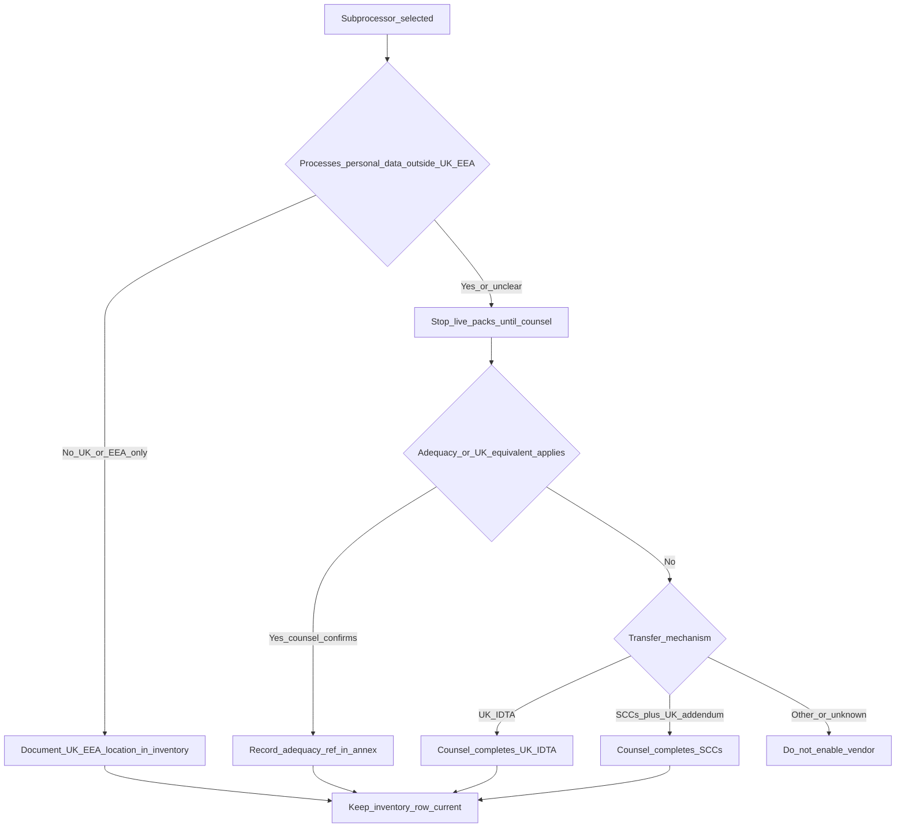

# International transfers — decision-tree annex stub (DPA companion)

**Epic:** [#5](https://github.com/thesnjk/BidHarbour/issues/5)  
**Status:** Draft annex outline for solicitor. **Not legal advice.**  
**Do not treat as an approved transfer mechanism. Do not send to customers until counsel clears.**  
**Aligns with:** [`dpa-stub.md`](dpa-stub.md) · [`subprocessors-and-data-flow.md`](subprocessors-and-data-flow.md) · [`../Docs/legal-data-policy.md`](../Docs/legal-data-policy.md) · [`pilot-privacy-notice-issue-spotter.md`](pilot-privacy-notice-issue-spotter.md)  
**Product name:** Supplier Desk (BidHarbour)

**Rule:** Hosting region alone does **not** establish UK GDPR compliance. This stub points counsel at mechanism **branches**; it does **not** paste SCCs / UK IDTA text verbatim. **Solicitor annex prevails when cleared.**

---

## 1. Decision tree (Path A pilot → Path B candidates)



ASCII fallback:

```text
Subprocessor selected
  └─ Personal data outside UK/EEA?
        ├─ No  → record UK/EEA location in inventory; continue
        └─ Yes / unclear
              └─ STOP live packs until counsel
                    ├─ Adequacy (counsel confirms) → record ref
                    ├─ UK IDTA → counsel completes annex
                    ├─ SCCs (+ UK addendum as advised) → counsel completes
                    └─ Other / unknown → do not enable vendor
```

---

## 2. Tie to working inventory

Source table: [`subprocessors-and-data-flow.md`](subprocessors-and-data-flow.md).

| Inventory function | Typical transfer risk (working) | Default until counsel |
|--------------------|----------------------------------|------------------------|
| Local encrypted disk | Usually none (device in UK) | Confirm device location / backups |
| Founder mailbox (Google / Microsoft TBC) | Possible if provider routes outside UK/EEA | Confirm region + mechanism |
| LLM draft assist (TBC) | Often third-country risk if used | Contract + minimise + mechanism **or** do not use on live packs |
| OCR / document parse (TBC) | Same as LLM if used | Same |
| App hosting / DB / object (post-GO) | Depends on region | Blocked until scorecard GO + counsel |
| Stripe / auth / transactional email (post-GO) | Provider-dependent | Candidate only |

---

## 3. Annex placeholder table *(blank until counsel / vendor selected)*

| Provider | Function | Data categories | Location(s) | Mechanism (adequacy / UK IDTA / SCCs / none) | Counsel status | Live packs allowed? |
|----------|----------|-----------------|-------------|-----------------------------------------------|----------------|---------------------|
| | | | | | `not_reviewed` | **No** |
| | | | | | | |

Tally: **0** rows counsel-cleared for live packs.

---

## 4. Founder / solicitor checkboxes

- [ ] Every `in_use_pilot` inventory row has a location answer  
- [ ] Any non-UK/EEA or unclear row has counsel mechanism **or** is disabled for live packs  
- [ ] LLM/OCR touching live packs: no-train/ZDR terms + transfer annex **or** unused  
- [ ] Cleared annex version stored outside git / vault; this stub left as issue-spotter  
- [ ] **Do not** claim compliance from “UK/EU region” wording alone  

---

## 5. Related

- DPA obligations heading → [`dpa-stub.md`](dpa-stub.md)  
- Privacy notice spotter → [`pilot-privacy-notice-issue-spotter.md`](pilot-privacy-notice-issue-spotter.md)  
- Solicitor pack → [`solicitor-send-checklist.md`](solicitor-send-checklist.md)
