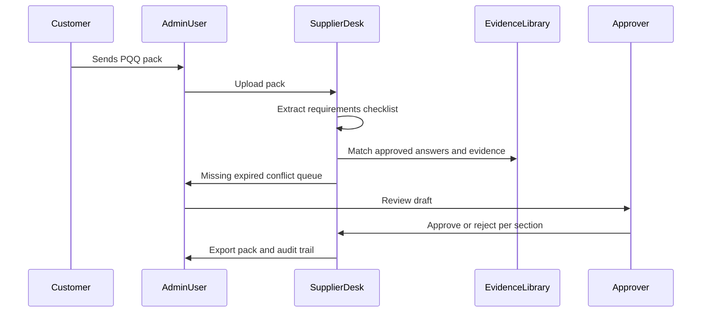

# 6. Jobs to be done and workflow map

**As-of:** 9 November 2025  
**Initial workflow selected:** Supplier Qualification Questionnaire (PQQ / SQ / assurance pack) — **only**. Do not merge RFQ, full tender, or estimating into MVP.

## Workflow types (scope control)

| Type | In v1? | Reason |
|------|--------|--------|
| Supplier qualification questionnaires | **Yes** | Narrowest profitable entry |
| Customer document / evidence requests | Partial (same engine) | Overlaps PQQ |
| RFQ administration | No | Estimating tools own pricing job |
| Tender submissions (public) | No | Tender SaaS crowded |
| Engineering estimates | No | Specialist judgement |

## Current-state → future-state map (PQQ)

| Step | Actor | Input | Action | Existing tool | Time (assumption) | Common failure | Consequence | Proposed intervention | Human approval |
|------|-------|-------|--------|---------------|-------------------|----------------|--------------|----------------------|----------------|
| 1. Receive | Admin | Email + attachments | Save pack | Outlook/Gmail | 10–20 min | Wrong version filed | Rework | Versioned Request upload | User confirms customer |
| 2. Understand asks | Admin / quality | Questionnaire | Skim / list asks | Word/PDF/Excel | 30–90 min | Missed tables/clauses | Incomplete pack | AI/assisted checklist + human edit | User |
| 3. Gather evidence | Admin | Certs, policies, insurance | Search folders | SharePoint/Desktop | 60–180 min | Expired/wrong file | Rejection/delay | Evidence library + expiry | User |
| 4. Draft answers | Admin | Prior answers | Copy/paste/adapt | Word/email | 60–120 min | Stale/unsupported claims | Risk | ApprovedAnswer match; abstain if none | Approver |
| 5. Internal review | MD / quality | Draft pack | Spot-check | Email | 20–60 min | Rubber-stamp | Liability | Structured Approval per section | **Approver** |
| 6. Submit | Admin | Final files | Email / portal | Customer portal | 15–40 min | Wrong attachment | Fail | Export pack + audit | Approver sign-off |
| 7. Archive | Admin | Submitted set | File somewhere | Folders | 10–20 min | Lost provenance | Next cycle slower | Request + Export history | — |

**Time totals:** 3–8+ hours typical *(Working assumption — measure in pilots).*

## Where product saves time vs specialist judgement

| Saves admin time | Remains human judgement |
|------------------|-------------------------|
| Finding prior answers/certs | Whether a capability claim is true |
| Checklist completeness | Commercial concessions |
| Expiry/conflict flags | Risk acceptance on gaps |
| Packaging export | Pricing / technical estimates |
| Audit trail | Legal interpretation of customer terms |

